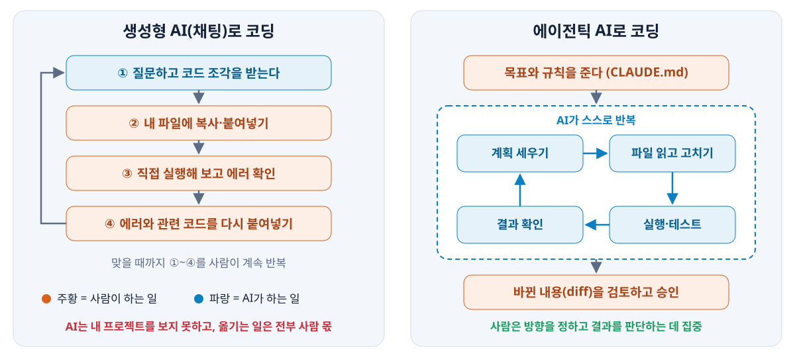
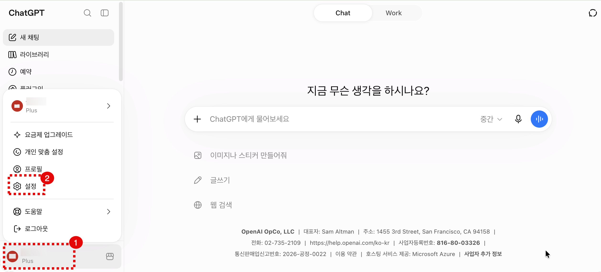

# 바이브 코딩을 위한 AI 사용 방법

AI 지침 설정과 올바른 프롬프트 작성 방법

<p class="sub">이광호 강사</p>

---

## AI의 세 갈래 — 생성형 · 에이전틱 · 피지컬


<Callout kind="eli5">
생성형 AI는 무엇이든 대답해 주는 박식한 친구, 에이전틱 AI는 일을 맡기면 알아서 처리하고 보고하는 비서, 피지컬 AI는 몸이 있어서 직접 물건을 나르는 비서다.
</Callout>

<!--
세 가지는 경쟁 관계가 아니라 같은 모델이 일하는 방식의 차이다. 에이전틱 AI 안에도 생성형 모델이 들어 있다.
-->

---

### 대표적인 예와 활용 사례

<Grid cols="3">
<div class="card py">
<h3>생성형 AI</h3>

**대표 예**

- ChatGPT · Claude · Gemini 채팅,     
  이미지 생성 Midjourney

**활용 사례**

- 보고서 · 이메일 초안 쓰기
- 긴 문서 요약과 번역
- 개념 설명, 질의응답
- 발표 자료에 넣을 이미지 만들기

</div>
<div class="card ok">
<h3>에이전틱 AI</h3>

**대표 예**

- Claude Code · OpenAI Codex · Cursor 에이전트 ·     
  GitHub Copilot 코딩 에이전트

**활용 사례**

- 저장소를 읽고 기능 구현 · 버그 수정
- 테스트를 돌려 보고 실패하면 다시 고치기
- 웹을 돌아다니며 자료 조사 · 정리
- 반복되는 데이터 정리 작업 자동화

</div>
<div class="card ai">
<h3>피지컬 AI</h3>

**대표 예**

- 자율주행차, 휴머노이드 로봇,     
  물류창고 로봇

**활용 사례**

- 운전자 없는 로보택시 운행
- 창고에서 물건 골라 담기 · 옮기기
- 공장 조립 · 품질 검사
- 위험한 현장 점검

</div>
</Grid>

<Callout kind="real">
이 강의에서 익힐 것은 가운데, 에이전틱 AI다. 코딩 작업은 채팅으로 묻는 것보다 에이전트에게 맡기고 검토하는 쪽이 빠르고 정확하다.
</Callout>

---

## 코딩은 채팅이 아니라 에이전트에게



- **채팅창은 내 프로젝트를 모른다.** 붙여 넣은 조각만 보고 답하므로, 다른 파일과 맞지 않는 코드가 자주 나온다
- **에이전트는 저장소를 직접 읽고, 고치고, 돌려 본다.** 복사 · 실행 · 에러 전달을 사람이 반복할 필요가 없다
- **그래서 익혀야 할 것은 "잘 묻기"보다 "잘 맡기기"다.** 작업을 작게 나눠 지시하고, 규칙 파일(`CLAUDE.md`)을 쓰고, 바뀐 내용을 검토하는 법

<Callout kind="warn">
에이전트도 틀린다. 바뀐 내용(diff)을 읽고 직접 실행해 확인하는 일은 끝까지 사람 몫이다.
</Callout>

---

## AI는 내 판단을 돕는 도구

학습이라는 목표에 충실하려면 코드는 내가 직접 작성한다. AI는 방향 · 해석 · 오류 진단을 맡는다.

<Steps>
<li><b>설계의 방향성</b> — 문제 해결 방법과 대안</li>
<li><b>결과의 해석</b> — 출력 결과를 읽는 방법(데이터 분석의 경우)</li>
<li><b>오류의 원인 진단</b> — 에러 메시지와 예상 밖 결과가 무엇을 가리키는지</li>
</Steps>

| 학습에 도움이 되는 사용 | 학습에 도움이 되지 않는 사용 |
|:--|:--|
| 두 방법 중 어느 쪽이 왜 나은지 판단 기준 묻기 | 코드 · 쿼리를 통째로 받아 붙여넣기 |
| 에러 메시지 읽는 법과 원인 후보 묻기 | 내 코드를 고쳐 달라고 하기 |
| 내 코드나 결과 해석의 허점 찾아 달라고 하기 | 결론 · 해석문을 통째로 생성 |

<span class="kicker">기준</span> "내가 이걸 설명할 수 있는가?" — 설명하지 못하면 아직 내 것이 아니다.

---

## 왜 ChatGPT부터 시작하나

목표는 에이전틱 AI(Claude Code)지만, **지침과 프롬프트를 쓰는 법은 ChatGPT에서 먼저 익힌다.** 돈과 준비물 없이 바로 시작할 수 있기 때문이다.

| | ChatGPT (채팅) | Claude Code (에이전트) |
|:--|:--|:--|
| 가격 | **무료로 시작** (유료는 Go $8 · Plus $20 / 월) | 무료 플랜에는 없다. **Claude Pro $20 / 월부터** (Max $100 · $200) |
| 시작 | 브라우저나 앱에서 로그인하면 끝 | 설치한 뒤 터미널이나 VS Code에서 프로젝트 폴더를 열어 실행 |
| 준비물 | 없다 | 터미널 명령, 폴더 · 파일 구조, Git 기초 |
| 지침 | 설정 → 개인 맞춤 설정 → 사용자 지정 지침 (무료 사용자도 가능) | 프로젝트 폴더의 `CLAUDE.md` 파일 |

<Callout kind="real" title="여기서 익힌 것이 그대로 이어진다">

- **사용자 지정 지침 → `CLAUDE.md`.** 매번 반복할 규칙을 한 번 적어 두는 같은 원리다
- **마크다운 프롬프트 → 에이전트에게 일 맡기기.** 맥락 · 상황 · 질문 · 제약 · 출력 형식으로 나눠 쓰는 습관은 Claude Code에서도 똑같이 쓴다

</Callout>

<Callout kind="warn">
가격은 2026년 10월 미국 달러 기준이고 세금은 별도다. 자주 바뀌니 수업 전에 chatgpt.com/pricing 과 claude.com/pricing 에서 다시 확인한다.
</Callout>

---

## 효율적인 AI 사용을 위한 필수 설정

매번 반복되는 요청은 지침으로 한 번만 설정한다.

<Callout kind="eli5" title="AI 지침이란">
한 번 설정해 두면 AI와의 모든 대화에 기본 전제로 작동하는 전역 프롬프트다.
</Callout>

<div class="kicker">AI 기본 지침의 필수 구성요소</div>

<Steps>
<li>역할을 방향성 · 해석 · 오류 진단 셋으로 한정</li>
<li>영역(SQL · 파이썬 · 분석)이 갈리면 먼저 물어보기</li>
<li>코드는 어떤 형태로도 출력 금지</li>
<li>내가 붙여 넣은 코드를 고쳐서 돌려주지 않기</li>
<li>사실 / 추론 / 추측을 구분해 표시</li>
<li>답변 끝에 "내가 확인할 점" 2~3줄</li>
</Steps>

<Callout kind="tip">
AI 지침은 별도로 배포되는 파일 「데이터 분석 학습을 위한 AI 사용 방법(프롬프트).md」를 확인한다.
</Callout>

<!--
한 번 설정해두면 이후 모든 대화에 자동 적용되고, 프로젝트별로 다른 지침을 걸 수도 있다. ChatGPT 맞춤 설정은 칸당 1,500자라 2,900자짜리 본문이 한 칸에 들어가지 않는다 — 두 칸에 나눠 넣거나 프로젝트 지침을 쓴다. 대화가 길어지면 챗봇이 지침 뒤쪽부터 흘리므로, 답이 지침을 벗어나면 새 대화를 여는 편이 빠르다.
-->

---

### ChatGPT 지침 설정 ① 설정 열기

<Steps>
<li>왼쪽 아래 내 계정 이름을 누른다</li>
<li>메뉴에서 <b>설정</b>을 고른다</li>
</Steps>



---

### ChatGPT 지침 설정 ② 지침 입력

<Steps style="counter-reset: step 2">
<li>설정 창 왼쪽에서 <b>개인 맞춤 설정</b>을 고른다</li>
<li><b>사용자 지정 지침</b> 칸에 지침을 붙여 넣는다</li>
</Steps>


<Callout kind="real">
이 칸에 넣은 내용은 AI가 요청을 처리하기 전에 기본 지침으로 적용된다.
</Callout>

---

### ChatGPT 지침 설정 ③ 지침 내용

배포 파일 「데이터 분석 학습을 위한 AI 사용 방법(프롬프트).md」의 내용을 그대로 쓴다.

| 묶음 | 항목 | 담긴 내용 |
|:--|:--:|:--|
| 역할과 범위 | 1~3 | 조교 역할 · 3영역 · 돕는 범위 셋 |
| 코드 금지 | 4~7 | 출력 형태 · 요청 거부 · 설명 수위 · 코드 수정 |
| 사고 방식 | 8~10 | 근거 먼저 · 사실/추론 표기 · 창작 금지 |
| 파이썬 기본 코딩 | 11~14 | 처리 순서 · 자료구조 비교 · 에러 읽는 법 |
| SQL | 15~18 | 절 단위 설계 · 행 수 원인 · 실행 계획 |
| 데이터 분석 | 19~22 | 대안 2개 · 전제와 한계 · 해석 범위 |
| 출력 형식 | 23~25 | 표 · 개조식 · 내가 확인할 점 · 출처 수위 |
| 문체 | 26~28 | 원어 병기 · 간결한 어투 · 본론부터 |

<!--
이 장은 낭독하지 않는다. 배포 파일을 열어 지금 각자 설정해 보라고 안내하고 실습 시간을 3분 준다. 지침 본문은 한 글자도 고치지 말고 그대로 붙여 넣게 한다.
-->

---

## 질문을 잘 던지는 법 — 프롬프트는 마크다운으로

<div class="kicker">맥락 + 상황 + 질문 + 제약 + 출력 형식을 <code>##</code> 제목으로 나눠 쓴다</div><br/>

<Grid cols="2">
<div>

<Callout kind="danger" title="나쁜 예">
"이 쿼리 왜 안 돼? 고쳐줘"
</Callout>

<Callout kind="real" title="프롬프트를 마크다운으로 쓰면 좋은 점">

- **AI가 지시를 빠뜨리지 않는다.** `##` 제목이 구성요소의 경계가 되어, 제약과 출력 형식이 질문에 묻히지 않는다
- **지시와 자료가 섞이지 않는다.** 에러 메시지 · 표 구조는 코드 상자(```` ``` ````)에 넣으면 AI가 자료로 읽는다
- **결과 모양을 그대로 받는다.** 표 머리글을 적어 두면 그 모양대로 채워서 돌려준다
- **고쳐 쓰고 다시 쓰기 쉽다.** `.md` 파일로 저장해 두고 `## 상황`만 바꿔 쓴다

</Callout>

<div class="kicker">원칙 3가지</div>

<Steps>
<li>영역을 먼저 밝힌다 — SQL인지 파이썬인지 분석인지</li>
<li>코드 대신 에러 메시지 · 표 구조 · 결과를 붙인다</li>
<li>한 번에 다 묻지 말고 한 단계씩</li>
</Steps>

</div>
<div>

<div class="kicker lab">좋은 예 — 구성요소마다 마크다운 제목을 붙인다</div>

<Prompt>

````md
## 맥락
SQL 수업 실습 중이야. 쿼리는 내가 직접 작성할 거야.

## 상황
주문 테이블과 고객 테이블을 고객ID로 조인했더니 예상보다 행 수가 많아졌어.

## 질문
원인 후보와, 내가 직접 확인할 방법을 알려줘.

## 제약
- 쿼리문은 주지 마
- 개념과 순서 위주로 정리해

## 출력 형식
| 원인 후보 | 확인 방법 |
마지막에 "내가 확인할 점" 2~3줄
````

</Prompt>

</div>
</Grid>

<!--
'[제약] 쿼리문은 주지 말 것' 한 줄이 이 수업 프롬프트의 핵심이다. 지침을 걸어뒀더라도 프롬프트에서 한 번 더 못박으면 확실하다. 영역을 밝히지 않으면 SQL 질문에 판다스로 답하는 식으로 어긋난다. 대화형의 장점은 되묻기라는 점도 함께 설명한다.
-->

---

## AI가 자주 틀리는 5가지

AI는 모른다고 말하는 대신 그럴듯하게 채운다.

| | 틀리는 방식 | 무슨 일이 생기나 |
|:--:|:--|:--|
| 1 | 내 것을 아는 척 | 본 적 없는 테이블명 · 컬럼명 · 변수명 · 수치를 지어낸다 |
| 2 | 추측을 사실처럼 | 추론임을 밝히지 않고 단정해서 쓴다 |
| 3 | 원인 단정 | 에러 · 이상 결과의 원인을 하나로 못박는다 |
| 4 | 출처 날조 | 없는 문서 · 가짜 링크를 만들어 낸다 |
| 5 | 해석 · 결론 대행 | 내 해석보다 먼저 결론을 써 준다 → 발표 · 질의응답에서 무너진다 |

<Callout kind="real" title="답을 받은 뒤 3단 체크">

1. 직접 돌려서 같은 결과가 나오는가
2. 내 영역(SQL · 파이썬 · 분석)에 맞는 답인가
3. 답이 지침을 벗어나면 대화가 너무 길어 AI가 감당하지 못하는 상황이다. 새 대화를 연다

</Callout>

<span class="kicker">기준</span> 내 해석이 먼저, AI는 점검자.

<!--
5번은 학생들이 잘 모르는 실패 모드다. 내가 원하는 결론을 흘리면 그쪽에 맞춘 근거가 돌아온다. 지침은 '추론하지 마'가 아니라 '추론임을 표시해'로 걸어둔다 — 추론 자체는 정상 작업이다. 대화가 길어지면 챗봇이 지침 뒤쪽부터 흘리므로, 고쳐 쓰라고 하지 말고 새 대화를 여는 편이 빠르다.
-->
