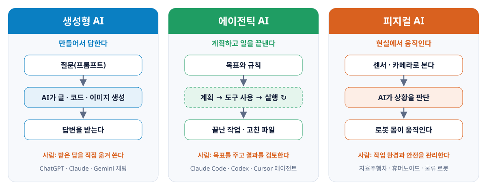
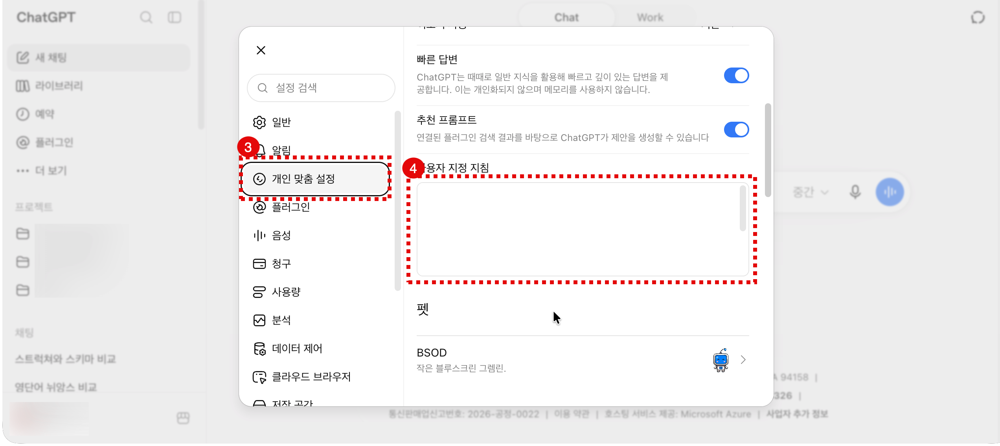

# 바이브 코딩을 위한 AI 사용 방법

AI 지침 설정과 올바른 프롬프트 작성 방법

<p class="sub">[LAB-00] AI의 이해 1 · {teacher} 강사</p>

---

## #01. 바이브 코딩(Vibe Coding)이란

<Callout kind="eli5" title="유래">

- 2025년 2월 안드레이 카파시(Andrej Karpathy)의 글에서 시작.     
  - "분위기(vibe)에 몸을 맡기고, 코드가 있다는 사실조차 잊는다"    
- 하고 싶은 것을 말로 설명하고, AI가 만든 결과를 보며 다시 말로 고치는 방식.

</Callout>

<Grid cols="2" align="start">
<div class="card ok">
<h3>좋아지는 것</h3>

- 아이디어에서 동작하는 결과까지의 시간 단축
- 문법 · 라이브러리 이름 대신 "무엇을 만들지"에 집중
- 처음 보는 언어 · 도구도 바로 시도 가능

</div>
<div class="card ai">
<h3>무너지는 곳</h3>

- 왜 돌아가는지 모름 → 고장 나면 못 고침
- 설명 못 하는 코드 → 발표 · 질의응답에서 드러남
- 그럴듯하면 검증 생략 → 틀린 분석이 그대로 나감

</div>
</Grid>

<Callout kind="real" title="권장하는 자세">
바이브 코딩은 도구이지 목표가 아님. 익히는 단계에서는 <b>코드는 내가, AI는 방향 · 해석 · 오류 진단</b>. 설명할 수 있게 된 뒤에 맡기는 범위를 넓힘
</Callout>

---

## #02. AI의 세 갈래 — 생성형 · 에이전틱 · 피지컬



---
layout: cards
---

## #03. 생성형 AI를 올바르게 사용하는 방법

<div class="py">

#### 생성형 AI — 질문하고 답을 받는다

- **언제** 개념을 이해하려고 질문하고 답을 얻을 때
- **주는 것** 질문(프롬프트). 맥락 · 상황 · 제약을 적어서
- **받는 것** 글 · 코드 · 이미지. 어디까지나 초안
- **사람의 몫** 받은 답을 직접 옮겨 쓰고, 돌려서 확인
- **예** ChatGPT · Claude · Gemini 채팅

</div>
<div class="ok">

#### 에이전틱 AI — 맡기고 결과를 검토한다

- **언제** 작업을 맡기고 결과물을 만들어야 할 때
- **주는 것** 목표와 규칙(`CLAUDE.md`). 작게 나눠서
- **받는 것** 끝난 작업 · 고친 파일. 계획 → 도구 사용 → 실행을 스스로 반복
- **사람의 몫** 방향을 정하고, 바뀐 내용(diff)을 읽고 승인
- **예** Claude Code · Codex · Cursor 에이전트

</div>
<div class="ai">

#### 피지컬 AI — 현실에서 움직이게 한다

- **언제** 현실의 물건을 옮기고 다루는 일을 맡길 때
- **주는 것** 작업 환경. 센서 · 카메라가 보는 현장
- **받는 것** 로봇의 움직임. 상황을 판단해 몸으로 수행
- **사람의 몫** 작업 환경과 안전을 관리
- **예** 자율주행차 · 휴머노이드 · 물류 로봇

</div>

---

## #04. 코딩은 채팅이 아니라 에이전트에게

<div class="fill-img"></div>

---
layout: cards
---

### #04-1. 에이전트에게 맡기면 달라지는 것

<div class="py">

#### 채팅창은 내 프로젝트를 모른다

- 붙여 넣은 조각만 보고 답한다
- 파일 구조 · 데이터 · 에러의 맥락은 내가 매번 설명해야 한다
- 답을 옮기고, 돌리고, 에러를 다시 붙여 넣는 왕복을 사람이 반복한다

</div>
<div class="ok">

#### 에이전트는 직접 읽고 · 고치고 · 돌려 본다

- 파일을 열어 구조를 파악하고 필요한 곳을 고친다
- 실행해 결과를 확인하고, 에러가 나면 스스로 고쳐 다시 돌린다
- 복사 · 실행 · 에러 전달을 사람이 반복할 필요가 없다

</div>
<div class="ai">

#### 익힐 것은 "잘 묻기"보다 "잘 맡기기"

- 작게 나눠 지시한다 — 한 번에 목표 하나
- 규칙은 `CLAUDE.md` 같은 파일에 적어 두고 매번 다시 설명하지 않는다
- 바뀐 내용(diff)을 읽고 나서 승인하고, 결과는 직접 실행해 확인한다

</div>

<Callout kind="warn">
에이전트도 틀림. 바뀐 내용(diff) 읽기와 직접 실행 확인은 끝까지 사람 몫
</Callout>

---

## #05. 두 영상으로 보는 AI 사용 시 주의할 점

<Grid cols="2" align="start">
<div>

<div class="kicker">영상 1 · 샌드위치 코딩</div>

<YoutubeCard id="3VG2OgkRJK0" width="100%" height="280" />

<p class="small muted">아이들이 쓴 레시피를 아빠가 글자 그대로 따라 하기 (3분 51초)</p>

</div>
<div>

<div class="kicker ai">영상 2 · 토니 스타크의 시간여행 시뮬레이션</div>

<YoutubeCard id="A-nNPoQn6Ok" width="100%" height="280" />

<p class="small muted">토니가 AI 프라이데이에게 모델링을 시키는 장면 (2분 4초)</p>

</div>
</Grid>

---

### #05-1. 각 영상이 시사하는 바

<Grid cols="2" align="start">
<div class="card py">
<h3>영상 1 · AI는 "내 뜻"이 아니라 "내 말"을 따름</h3>

- **머릿속 전제는 전달되지 않음** — AI도 내 프로젝트 · 데이터 · 업무 맥락을 모른 채 시작
- **애매한 말은 엉뚱하게 읽힘** — 영역 · 상황 · 제약이 없으면 그럴듯한 쪽을 고름
- **결과를 보고 지시를 고침** — AI를 탓하기 전에 내 프롬프트에서 빠진 조건 찾기

</div>
<div class="card ai">
<h3>영상 2 · 생각은 사람이, 계산은 AI가</h3>

- **아이디어와 방향은 사람 몫** — "뫼비우스의 띠, 뒤집어서"는 토니의 생각, 프라이데이는 계산만
- **알아야 제대로 시킴** — 모르는 영역은 요청도 애매하고 틀린 답도 못 알아챔
- **결과는 가설, 검증은 사람** — "맞는지 확인해 보자" → AI의 답도 직접 돌려서 확인

</div>
</Grid>

---
layout: cards
---

### #05-2. 두 영상을 합치면 — AI 사용 원칙 세 가지

<div class="py">

#### ① 빠짐없이 적어서 건네기 — 영상 1

- 맥락 · 상황 · 제약은 머릿속이 아니라 프롬프트에 적는다
- 아이들의 레시피처럼, 적지 않은 전제는 전달되지 않는다
- 결과가 엉뚱하면 AI를 탓하기 전에 빠진 조건을 찾는다

</div>
<div class="ai">

#### ② 방향은 내가 정하기 — 영상 2

- 무엇을 시도할지, 어느 영역의 문제인지는 내가 고른다
- "뫼비우스의 띠, 뒤집어서"처럼 아이디어는 사람 몫, 계산은 AI 몫
- 모르는 영역은 요청도 애매하고 틀린 답도 못 알아챈다

</div>
<div class="ok">

#### ③ 검증은 내가 하기 — 영상 2

- AI의 답은 가설. 직접 돌려 확인하기 전까지는 결과가 아니다
- "맞는지 확인해 보자" — AI가 준 계산도 다시 돌려 본다
- 설명할 수 없는 결과는 내보내지 않는다

</div>

<Callout kind="real">
뒤에서 다루는 AI 지침과 마크다운 프롬프트 = 이 세 가지를 습관으로 만드는 틀
</Callout>

---

## #06. AI는 내 판단을 돕는 도구

코드는 내가 직접 작성. AI는 방향 · 해석 · 오류 진단

<Steps>
<li><b>설계의 방향성</b> — 해결 방법과 대안</li>
<li><b>결과의 해석</b> — 출력 결과를 읽는 법 (데이터 분석)</li>
<li><b>오류의 원인 진단</b> — 에러 메시지 · 예상 밖 결과의 의미</li>
</Steps>

| 도움이 되는 사용 | 도움이 되지 않는 사용 |
|:--|:--|
| 두 방법의 판단 기준 묻기 | 코드 · 쿼리를 통째로 받아 붙여넣기 |
| 에러 읽는 법 · 원인 후보 묻기 | 내 코드를 고쳐 달라고 하기 |
| 내 해석의 허점 찾아 달라고 하기 | 결론 · 해석문을 통째로 생성 |

<span class="kicker">기준</span> "내가 이걸 설명할 수 있는가?" — 설명하지 못하면 아직 내 것이 아님

---

## #07. ChatGPT부터 시작하는 이유

목표는 에이전틱 AI(Claude Code). 지침과 프롬프트 쓰는 법은 **돈과 준비물 없이 바로 시작할 수 있는 ChatGPT에서 먼저** 익힘

| | ChatGPT (채팅) | Claude Code (에이전트) |
|:--|:--|:--|
| 가격 | 무료로 시작 (유료 Go $8 · Plus $20 / 월) | Claude Pro $20 / 월부터 (Max $100 · $200) |
| 시작 | 브라우저 · 앱 로그인으로 끝 | 설치 후 터미널 · VS Code 에서 프로젝트 폴더 열기 |
| 준비물 | 없음 | 터미널 명령 · 폴더 구조 · Git 기초 |
| 지침 | 설정 → 개인 맞춤 설정 → 사용자 지정 지침 | 프로젝트 폴더의 `CLAUDE.md` |

<span class="small muted">가격은 2026년 10월 미국 달러 기준 · 세금 별도. 사용 전 chatgpt.com/pricing · claude.com/pricing 재확인</span>

---

## #08. 효율적인 AI 사용을 위한 필수 설정

매번 반복되는 요청은 지침으로 한 번만 설정

<Callout kind="eli5" title="AI 지침이란">
한 번 설정하면 모든 대화에 기본 전제로 작동하는 전역 프롬프트
</Callout>

<div class="kicker">AI 기본 지침의 필수 구성요소</div>

<Grid cols="2" align="start">
<div>

<Steps>
<li>역할은 방향성 · 해석 · 오류 진단 셋으로 한정</li>
<li>영역(SQL · 파이썬 · 분석)이 갈리면 먼저 질문</li>
<li>코드는 어떤 형태로도 출력 금지</li>
</Steps>

</div>
<div>

<Steps style="counter-reset: step 3">
<li>붙여 넣은 코드를 고쳐서 돌려주지 않기</li>
<li>사실 / 추론 / 추측 구분 표시</li>
<li>답변 끝에 "내가 확인할 점" 2~3줄</li>
</Steps>

</div>
</Grid>

---

### #08-1. ChatGPT 지침 설정 ① 설정 열기

<Steps>
<li>왼쪽 아래 내 계정 이름 클릭</li>
<li>메뉴에서 <b>설정</b> 선택</li>
</Steps>

<div class="fill-img"></div>

---

### #08-2. ChatGPT 지침 설정 ② 지침 입력

<Steps style="counter-reset: step 2">
<li>설정 창 왼쪽에서 <b>개인 맞춤 설정</b> 선택</li>
<li><b>사용자 지정 지침</b> 칸에 지침 붙여 넣기</li>
</Steps>

<div class="fill-img"></div>

---

### #08-3. ChatGPT 지침 설정 ③ 지침 내용

배포 파일 「ChatGPT 지침.md」의 내용을 그대로 사용

| 묶음 | 항목 | 담긴 내용 |
|:--|:--:|:--|
| 역할 · 코드 금지 | 1~7 | 조교 역할, 3영역, 코드 출력 · 수정 금지 |
| 사고 방식 | 8~10 | 근거 먼저, 사실 / 추론 표기, 창작 금지 |
| 영역별 지침 | 11~22 | 파이썬 · SQL · 데이터 분석 각각의 돕는 방식 |
| 출력 · 문체 | 23~28 | 표 · 개조식, "내가 확인할 점", 간결한 어투 |

---

## #09. 질문을 잘 던지는 법 — 프롬프트는 마크다운으로

<div class="kicker">맥락 + 상황 + 질문 + 제약 + 출력 형식을 <code>##</code> 제목으로 구분</div>

<div>

<Callout kind="danger" title="나쁜 예">
"이 쿼리 왜 안 돼? 고쳐줘"
</Callout>

<Callout kind="real" title="마크다운으로 쓰면 좋은 점">

- **지시를 빠뜨리지 않음**
  - `##` 제목이 경계가 되어 제약 · 출력 형식이 묻히지 않음
- **지시와 자료가 섞이지 않음**
  - 코드나 에러 메시지 코드 상자에 작성하여 일반 지시문과 구별
- **고쳐 쓰기 쉬움**     
  - `.md` 파일로 저장해 두고 `## 상황`만 바꿔 재사용

</Callout>

</div>

---
class: dense
---

### #09-1. 좋은 예 — 구성요소마다 마크다운 제목

<Prompt cols="2">

````md
## 맥락

SQL을 익히는 중이야. 쿼리는 내가 직접 작성할 거야.

## 상황

주문 테이블과 고객 테이블을 고객ID로 조인했더니    
예상보다 행 수가 많아졌어.

## 질문

원인 후보와, 내가 직접 확인할 방법을 알려줘.

## 제약

- 쿼리문은 주지 마
- 개념과 순서 위주로 정리해

## 출력 형식

| 원인 후보 | 확인 방법 |

마지막에 "내가 확인할 점" 2~3줄
````

</Prompt>

---

## #10. 환각(Hallucination) — AI의 거짓말

AI가 그럴듯하게 지어낸 것을 사람이 그대로 믿었을 때 생긴 사건들

| 분야 | 사건 | 결과 |
|:--|:--|:--|
| 법률 (2023 · 미국) | ChatGPT가 알려 준 판례 6건을 서면에 인용 → 전부 존재하지 않는 판례 | 변호사 · 로펌에 벌금 5,000달러 (Mata v. Avianca) |
| 고객 상담 (2024 · 캐나다) | 에어캐나다 챗봇이 규정과 다른 조문 할인 안내 | "챗봇의 말도 회사 책임" → 배상 명령 |
| 코딩 (2025 · 연구) | AI가 추천한 패키지 이름의 약 20%가 존재하지 않음 → 공격자가 그 이름으로 악성 패키지 등록 (slopsquatting) | 확인 없이 설치하면 악성 코드를 직접 실행 |

<Callout kind="warn">
공통점은 AI가 틀린 것이 아니라 <b>사람이 확인하지 않은 것</b>. 책임은 AI가 아니라 그 답을 쓴 사람에게
</Callout>

---

## #11. AI가 자주 틀리는 5가지

AI는 모른다고 말하는 대신 그럴듯하게 채움

| | 틀리는 방식 | 결과 |
|:--:|:--|:--|
| 1 | 내 것을 아는 척 | 본 적 없는 테이블 · 컬럼 · 변수명 · 수치를 지어냄 |
| 2 | 추측을 사실처럼 | 추론임을 밝히지 않고 단정 |
| 3 | 원인 단정 | 에러 · 이상 결과의 원인을 하나로 못박음 |
| 4 | 출처 날조 | 없는 문서 · 가짜 링크 생성 |
| 5 | 해석 · 결론 대행 | 내 해석보다 먼저 결론 → 발표 · 질의응답에서 무너짐 |

<div class="kicker">답을 받은 뒤 3단 체크 — 내 해석이 먼저, AI는 점검자</div>

<Grid cols="3">
<div class="card ok"><p><b>① 직접 돌려 보기</b> — 같은 결과가 나오는가</p></div>
<div class="card ok"><p><b>② 내 영역인가</b> — SQL · 파이썬 · 분석에 맞는 답인가</p></div>
<div class="card ok"><p><b>③ 길어지면 새 대화</b> — 지침을 벗어나면 대화가 너무 길어진 것</p></div>
</Grid>

---

## #12. AI 슬롭(AI Slop) — AI로 찍어낸 질 낮은 콘텐츠

<Callout kind="eli5" title="슬롭(slop)이란">

- 원래 뜻은 돼지에게 주는 음식 찌꺼기
- 지금은 <b>AI로 대량 생산된 질 낮은 디지털 콘텐츠를 의미</b>.

</Callout>

<Grid cols="3" align="start">
<div class="card py">
<h3>흔한 형태</h3>

- SNS 피드의 AI 이미지 · 영상
- 검색 상위의 AI 블로그 글
- AI로 찍어낸 전자책 · 음악

</div>
<div class="card ai">
<h3>확산 원인</h3>

- 만드는 비용이 0에 가까움
- 품질 대신 양과 클릭 수로 승부
- 알고리즘이 요청 없이도 밀어 줌

</div>
<div class="card ok">
<h3>부작용</h3>

- 진짜 정보가 묻힘
- 검색과 AI가 슬롭을 다시 학습
- 읽는 사람의 시간과 신뢰 소모

</div>
</Grid>

---

### #12-1. 워크슬롭 — 내 결과물도 슬롭이 될 수 있다

<Callout kind="warn" title="워크슬롭(workslop)">
"좋은 일처럼 보이지만 과제를 진전시킬 알맹이가 없는 AI 생성 업무 결과물"
</Callout>

| 자주 보이는 징후 | 예 |
|:--|:--|
| 어디에나 맞는 말 | "전처리로 데이터 품질을 높였다" — 무엇을 어떻게 처리했는지가 없음 |
| 숫자 없는 해석 | "유의미한 상관관계" — 어떻게 유의미한것인지 없음 |
| 설명 못 하는 코드 | 왜 그 옵션인지 물으면 답 못 함 |
| 없는 출처 | 열리지 않는 링크 · 존재하지 않는 논문 |

---

### #12-2. 슬롭을 만들지 않기 위한 유의점

<Steps>
<li><b>보내기 전에 내가 먼저 읽기</b> — 검토를 받는 사람에게 떠넘기지 않기</li>
<li><b>구체적 근거 붙이기</b> — 컬럼명 · 수치 · 실행 결과 없는 문장은 어디에나 맞는 말</li>
<li><b>설명 못 하는 것은 내보내지 않기</b> — 코드 한 줄, 해석 한 문장도 질문받으면 답할 수 있어야 함</li>
<li><b>AI가 준 출처는 직접 열어 보기</b> — AI도 슬롭을 읽고 답함. 열리지 않는 링크 = 없는 출처</li>
</Steps>

<Callout kind="real">
AI를 쓰지 말라는 뜻이 아님. <b>AI 출력은 초안, 결과물은 내 이름으로.</b> 양을 늘리는 데 쓰면 슬롭, 내 판단을 점검하는 데 쓰면 도구
</Callout>

<span class="kicker">기준</span> "내가 이걸 설명할 수 있는가?" — 슬롭을 거르는 기준도 같음

---
layout: cover
hideInToc: true
---

# 감사합니다

질문과 토론 환영

<p class="sub">[LAB-00] AI의 이해 1 · 이광호 강사</p>
