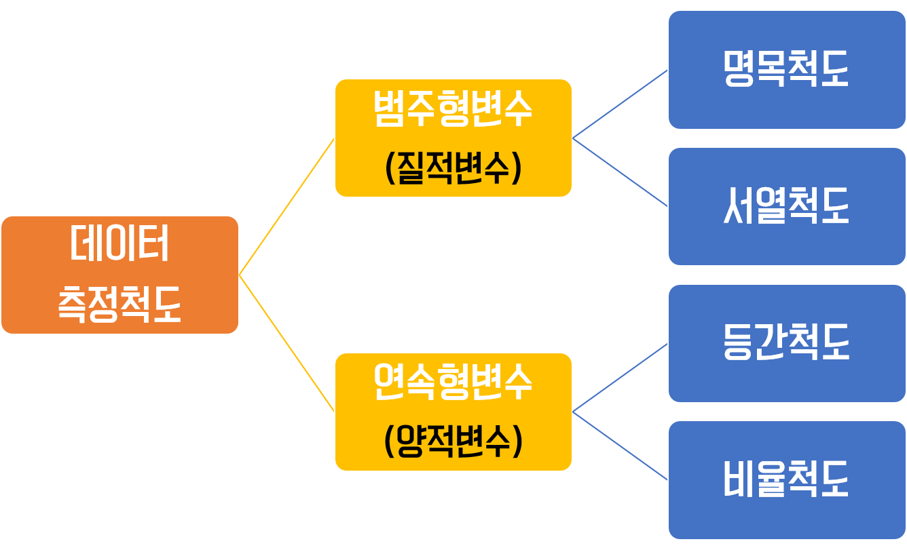

# 데이터 요약

R 데이터 분석 · 03강

---

## 학습목표

- 변수의 종류를 구분할 수 있다.
- 막대그래프, 히스토그램, 점도표가 무엇인지 설명할 수 있다.
- 평균, 분산, 표준편차를 계산할 수 있다.
- 평균, 분산, 표준편차, 최빈값, 변이계수의 특징을 설명할 수 있다.
- 중앙값, 사분위수, 사분위수 범위, 백분위수, 범위, 다섯 수치요약이 무엇인지 설명할 수 있다.
- 상자그림이 무엇인지 설명할 수 있다.

---

---

### 범주형 변수(질적척도)

범주형자료，숫자들 의 크기 차이가 계산 되지 않는 척도

| 구분     | 설명                                                                                                                                                                                                                      | 예시                                                        |
| -------- | ----------------------------------------------------------------------------------------------------------------------------------------------------------------------------------------------------------------------- | ----------------------------------------------------------- |
| 명목척도 | - 대상을 특성에 따라 카테고리로 분류하여 기호를 부여한 것 - 측정이 이루어지는 항목들이 상호배타적인 특성만 가진척도 - 측정 대상이 어느 집단에 속하는지 분류할 때 사용 - **단순한 번호로 차례의 의미는 없다.**                                             | 성별, 이름, 악기,  번호, 지역 등                        |
| 순서척도 | - 대상의 특성들을 구분할 수 있으며 이들 사이의 상대적인 크기를 나타낼 수 있고 서로 간 비교가 가능한 척도 - 명목척도들 중 항목들 간에 서열이나 순위가 존재하는 척도 - 측정 대상의 서열관계를 관측하는 척도 - 매겨진 숫자의 크기를 의미있게 활용할 수 있다. | 교육정도 (중졸, 고졸, 대졸 이상), 선호도 순위, 학점 |

---

### 연속형 변수(양적척도)

수치형자료，숫자들의 크기 차이를 계산 할수있는척도

| 구분           | 설명                                                                                                                                                                                                                                                                                                                                              | 예시                                                                                                          |
| -------------- | ------------------------------------------------------------------------------------------------------------------------------------------------------------------------------------------------------------------------------------------------------------------------------------------------------------------------------------------------- | ------------------------------------------------------------------------------------------------------------- |
| 구간(등간)척도 | - 상호간의 서열뿐 아니라 인접한 두 변수 값의 차이가 일정한 변수 - 서열척도들 중 항목들 간의 간격이 일정한 척도 - 측정 대상이 갖고 있는 속성의 양을 측정하는 것으로 **구간이나 구간 사이의 간격이 의미가 있는 자료** - 절대적 크기는 측정할 수 없기 때문에 사칙연산 중 더하기와 빼기는 가능하지만 비율처럼 곱하거나 나누는 것은 불가능 | 온도, IQ, 시각, 만족도 (매우불만족, 약간불만족, 보통, 약간만족, 매우만족)                                   |
| 비율척도       | - 상호간 서열, 크기 차이, 크기의 비교, 특성들 간의 계산까지 가능한 척도 - 등간척도 중 아무 것도 없는 상태를 `0`으로 정할 수 있는 척도 - 간격(차이)에 대한 비율이 의미를 가지는 자료 - **절대적 기준인 0이 존재**하고 사칙연산이 가능하며 제일 많은 정보를 가지는 척도                                                                 | 몸무게, 키, 나이, 길이, 임금 ( 20세 이하,21~30세,31~40세,41~50세, 0이라는 개념은 아직 태어나지 않음을 뜻함) |
