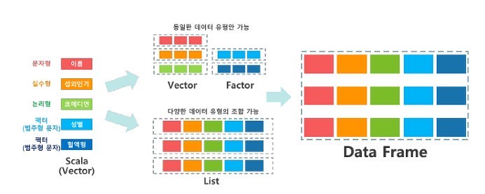

# 변수와 데이터 타입

<p class="sub">R 데이터 분석 · 05강</p>

---

## #01. R에서 사용되는 데이터의 종류

- **변수**: 변할 수 있는 수 (일반적인 프로그래밍에서 사용되는 개념)
- **스칼라**: R에서 프로그래밍의 변수를 부르는 용어

<div class="fill-img"></div>

---

### 데이터의 종류 (1)

<div class="kicker">1) 스칼라</div>

| 이름 | 설명 |
| ------ | --------------------------------------------------------------------------- |
| 숫자형 | 기본적으로 실수 형식. 정수로 표현하기 위해서는 숫자값 뒤에 L을 표시해야 함. |
| 논리형 | 참(TRUE), 거짓(FALSE) 중 하나를 갖는 값. |
| 문자열 | 쌍따옴표나 홑따옴표로 감싼 문장 |

<div class="kicker">2) 같은 종류의 값들로 구성되는 그룹 형태</div>

| 이름 | 설명 |
| ------------- | ---------------------------------------------------------------------- |
| 백터 | 같은 종류의 값들을 c 라는 명령어로 묶어서 나열. → 벡터들은 동질적이다. |
| 행렬 | 백터를 나열한 형태 |
| 요인 (factor) | 범주를 갖는 값. ex) 성별, 도시이름 등 |

---

### 데이터의 종류 (2)

<div class="kicker">3) 서로 다른 종류의 값들로 구성</div>

| 이름 | 설명 |
| ------ | -------------------------------------------------------------------------------------------------------- |
| 리스트 | 서로 다른 종류의 값들을 그룹으로 묶어 놓은 형식으로 일반적인 프로그래밍 언어에서 말하는 배열의 개념이다. |

<div class="kicker">4) 최종 형태</div>

| 이름 | 설명 |
| --------- | -------------------------------------------------------------- |
| DataFrame | 데이터 분석을 위한 종합적인 자료형. 엑셀 시트를 생각하면 좋다. |

---

## #02. 함수

프로그램 코드를 하나의 명령으로 그룹화 한 재사용 가능한 단위

> $f(x) = x + 1$

| 이름 | 명칭 | 수학에서의 의미 | R에서의 의미 |
| ---- | ---- | ---------------------------------------------------------- | ------------------------ |
| $x$ | 변수 | 변할 수 있는 수 | 분석가가 정의한 데이터 |
| $f$ | 함수 | 정의된 조건값($x$)이 활용되는 수식을 재사용하기 위한 단위. | R에서 제공하는 기본 기능 |

<Callout kind="eli5">
함수란, R에서 특정 결과를 도출하기 위해 사용하는 명령어로 이해하자.
</Callout>

---

## #03. 스칼라 값의 기본 자료형

- 아래의 형식으로 변수를 정의할 수 있다.
- 이름은 각자 편의에 따라 정의하면 된다.
- `이름 <- 값` 형식으로 임의의 데이터를 저장할 수 있다.

---

### 1) 문자형(character)

- 쌍따옴표나 홑따옴표로 감싸진 문장 형태의 데이터
- `print()` 함수로 내용을 출력, `typeof()` 함수로 값의 종류를 확인

<Grid cols="2">
<div>

<div class="kicker">변수 만들고 출력하기</div>

```r
char <- "Hello World"
print(char)
```

<Output>

```text
[1] "Hello World"
```

</Output>

</div>
<div>

<div class="kicker">값의 종류 확인하기</div>

```r
char <- "Hello World"
type <- typeof(char)
print(type)
```

<Output>

```text
[1] "character"
```

</Output>

</div>
</Grid>

---

### 3) 숫자형 — 실수(double)

R에서는 기본적으로 모든 숫자 형태의 값을 실수로 인지한다. 정수를 대입하더라도 실수로 식별한다.

<Grid cols="2">
<div>

```r
number1 <- 123
print(number1)

# 함수가 중첩 사용되는 경우 안쪽의 함수부터 실행된다.
print(typeof(number1))
```

<Output>

```text
[1] 123
[1] "double"
```

</Output>

</div>
<div>

<div class="kicker">소수점을 갖는 실수형</div>

```r
number2 <- 3.14
print(number2)
print(typeof(number2))
```

<Output>

```text
[1] 3.14
[1] "double"
```

</Output>

</div>
</Grid>

---

### 숫자형 — 정수(integer)

정수형을 사용하기 위해서는 숫자 뒤에 알파벳 대문자 `L`을 명시적으로 적용해야 한다.

```r
number3 <- 123L
print(number3)
print(typeof(number3))
```

<Output>

```text
[1] 123
[1] "integer"
```

</Output>

---

### 3) 논리형 (logical) / 특수한 값 — NULL

<Grid cols="2">
<div>

<div class="kicker">논리형 — 참(TRUE), 거짓(FALSE)</div>

```r
is <- TRUE
print(is)
print(typeof(is))
```

<Output>

```text
[1] TRUE
[1] "logical"
```

</Output>

</div>
<div>

<div class="kicker">NULL — 결정되지 않은 값</div>

```r
sp1 <- NULL
print(sp1)
print(typeof(sp1))
```

<Output>

```text
[1] NULL
[1] "NULL"
```

</Output>

</div>
</Grid>

---

### 특수한 값 — NA / NaN

<Grid cols="2">
<div>

<div class="kicker">NA — 결측값, 손실된 값</div>

```r
sp2 <- NA
print(sp2)
print(typeof(sp2))
```

<Output>

```text
[1] NA
[1] "logical"
```

</Output>

</div>
<div>

<div class="kicker">NaN — 수학적으로 정의되지 않은 값</div>

```r
sp3 <- NaN
print(sp3)
print(typeof(sp3))
```

<Output>

```text
[1] NaN
[1] "double"
```

</Output>

</div>
</Grid>

---

### 특수한 값 — Inf(무한대)

잘 사용되지 않는 값이다.

```r
sp4 <- Inf
print(sp4)
print(typeof(sp4))
```

<Output>

```text
[1] Inf
[1] "double"
```

</Output>

---
layout: section
---

# #04. 스칼라 값에 대한 연산자

---

### 1) 산술연산자 — 더하기 / 빼기

<Grid cols="2">
<div>

<div class="kicker">더하기</div>

```r
# 연산을 위해 사용될 스칼라 값 정의
x <- 5L
y <- 3L
print(x + y)
```

<Output>

```text
[1] 8
```

</Output>

</div>
<div>

<div class="kicker">빼기</div>

```r
x <- 5L
y <- 3L
print(x - y)
```

<Output>

```text
[1] 2
```

</Output>

</div>
</Grid>

---

### 산술연산자 — 곱하기 / 제곱근

제곱근은 `**` 연산자와 `^` 연산자 두 개가 존재한다. (차이 없음)

<Grid cols="2">
<div>

<div class="kicker">곱하기</div>

```r
x <- 5L
y <- 3L
print(x * y)
```

<Output>

```text
[1] 15
```

</Output>

</div>
<div>

<div class="kicker">제곱근</div>

```r
x <- 5L
y <- 3L
print(x ** y)
print(x ^ y)
```

<Output>

```text
[1] 125
[1] 125
```

</Output>

</div>
</Grid>

---

### 산술연산자 — 나누기

- `/` 실수 부분까지 계산한다.
- `%/%` 정수 부분의 몫만 취한다.
- `%%` 나눗셈의 나머지만 취한다.

<Grid cols="2">
<div>

```r
x <- 5L
y <- 3L
print(x / y)
print(x %/% y)
print(x %% y)
```

</div>
<div>

<Output>

```text
[1] 1.666667
[1] 1
[1] 2
```

</Output>

</div>
</Grid>

---

### 2) 비교연산자

연산 결과가 참(TRUE) 혹은 거짓(FALSE) 형태로 나타남

<Grid cols="2">
<div>

<div class="kicker">같다(==), 다르다(!=)</div>

```r
x <- 5L
y <- 3L
print(x == y)   # 같은지 여부를 비교
print(x != y)   # 다름을 비교
```

<Output>

```text
[1] FALSE
[1] TRUE
```

</Output>

</div>
<div>

<div class="kicker">크기 비교</div>

```r
x <- 5L
y <- 3L
print(x < y)    # 미만
print(x <= y)   # 이하
print(x > y)    # 초과
print(x >= y)   # 이상
```

<Output>

```text
[1] FALSE
[1] FALSE
[1] TRUE
[1] TRUE
```

</Output>

</div>
</Grid>

---

### 3) 논리연산자 — AND(&) / OR(|)

<Grid cols="2">
<div>

<div class="kicker">AND (&) — 모두 참이어야 참</div>

```r
print(TRUE & TRUE)
print(TRUE & FALSE)
print(FALSE & TRUE)
print(FALSE & FALSE)
```

<Output>

```text
[1] TRUE
[1] FALSE
[1] FALSE
[1] FALSE
```

</Output>

</div>
<div>

<div class="kicker">OR (|) — 하나라도 참이면 참</div>

```r
print(TRUE | TRUE)
print(TRUE | FALSE)
print(FALSE | TRUE)
print(FALSE | FALSE)
```

<Output>

```text
[1] TRUE
[1] TRUE
[1] TRUE
[1] FALSE
```

</Output>

</div>
</Grid>

---

### 비교식과 함께 AND (&) 사용

비교식의 결과는 그 자체가 참, 거짓을 의미하므로 비교식끼리 논리연산을 수행할 수 있다.

```r
print(5 > 3 & 10 > 7)    # TRUE & TRUE
print(5 < 3 & 10 > 7)    # FALSE & TRUE
print(5 > 3 & 10 < 7)    # TRUE & FALSE
print(5 < 3 & 10 < 7)    # FALSE & FALSE
```

<Output>

```text
[1] TRUE
[1] FALSE
[1] FALSE
[1] FALSE
```

</Output>

---

### 비교식과 함께 OR (|) 사용

```r
print(5 > 3 | 10 > 7)    # TRUE | TRUE
print(5 < 3 | 10 > 7)    # FALSE | TRUE
print(5 > 3 | 10 < 7)    # TRUE | FALSE
print(5 < 3 | 10 < 7)    # FALSE | FALSE
```

<Output>

```text
[1] TRUE
[1] TRUE
[1] TRUE
[1] FALSE
```

</Output>

---

### 논리값 부정 (!) → NOT

TRUE와 FALSE의 결과를 뒤집는다.

```r
foo <- TRUE
bar <- !foo
print(bar)
```

<Output>

```text
[1] FALSE
```

</Output>
