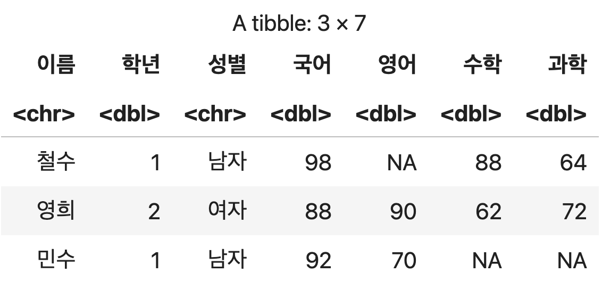
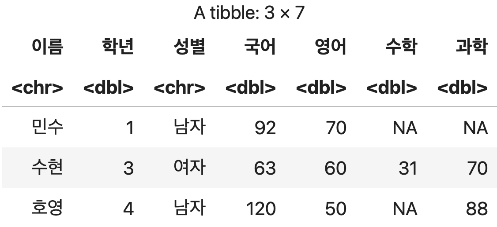
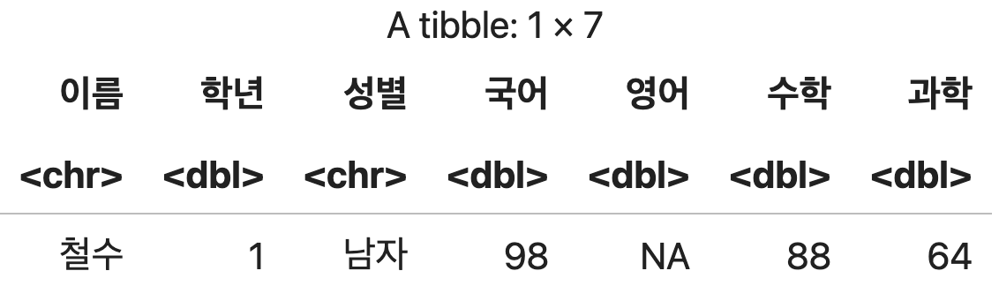
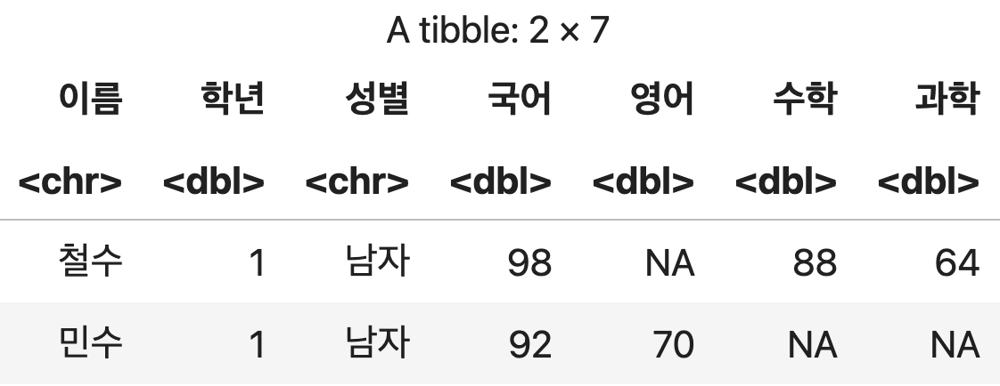
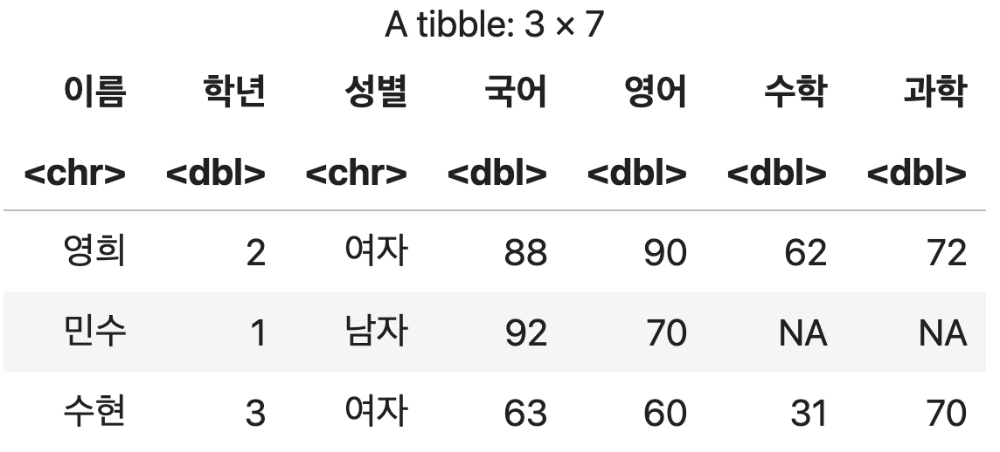
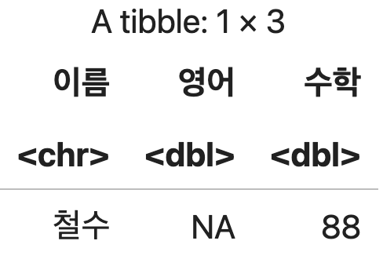
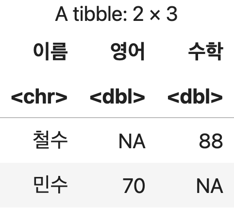
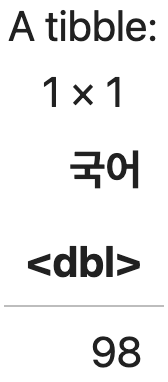

# 데이터 확인하기

<p class="sub">R 데이터 분석 · 18강</p>

---
layout: section
---

# #01. 패키지 로드 및 샘플 데이터프래임 구성

---

### 패키지 로드하기

```r
REPO_URL <- "https://cran.seoul.go.kr/"
if (!require(readxl)) install.packages("readxl", repos=REPO_URL)
library(readxl)
```

---

### 데이터 프레임 구성하기

```r
## 저장할 파일 이름
filename <- 'helloworld.xlsx'

## 엑셀 파일 다운로드 받기
download.file("http://data.hossam.kr/grade.xlsx", filename, mode='wb')

## 다운로드 받은 파일을 데이터 프레임으로 변환
성적표xlsx <- read_excel(filename, sheet="grade")

## 결과 출력
성적표xlsx
```

---

### 데이터 프레임 구성하기 (계속)

<div class="kicker">💻 출력결과</div>

<div class="fill-img"></div>

---
layout: section
---

# #02. 데이터의 개요 확인

---

### 1) 각 열의 이름 확인

`name()` 함수에 확인하고자 하는 데이터프레임을 파라미터로 전달한다.

<div class="kicker">컬럼 이름 확인하기</div>

```r
컬럼이름 <- names(성적표xlsx)
컬럼이름
```

<Output>

```text
'이름''학년''성별''국어''영어''수학''과학'
```

</Output>

---

### 2) 데이터의 크기 확인 (행,열의 수 구하기)

`dim()` 함수에 확인하고자 하는 데이터프레임을 파라미터로 전달한다.

<div class="kicker">데이터 프레임의 행,열 수 구하기</div>

```r
크기 <- dim(성적표xlsx)
크기
```

<Output>

```text
5  7
```

</Output>

---

### 3) 상위 n건 확인하기

`head()` 함수에 확인하고자 하는 데이터프레임과 조회하고자 하는 행의 수를 파라미터로 전달한다.

두 번째 파라미터를 생략할 경우 6건을 기본으로 가져온다.

<div class="kicker">상위 3건 가져오기</div>

```r
상위데이터 <- head(성적표xlsx, 3)
상위데이터
```

<div class="fill-img"></div>

---

### 4) 하위 n건 확인하기

`tail()` 함수에 확인하고자 하는 데이터프레임과 조회하고자 하는 행의 수를 파라미터로 전달한다.

두 번째 파라미터를 생략할 경우 6건을 기본으로 가져온다.

- 하위 n건 가져오기

```r
하위데이터 <- tail(성적표xlsx, 3)
하위데이터
```

<div class="fill-img"></div>

---
layout: section
---

# #03. 데이터 접근하기

---

### 1) 열 단위로 접근하기

`데이터프레임이름$열이름` 형식으로 접근한다.

<Grid cols="2">
<div>

<div class="kicker">print() 함수를 사용하여 출력 하기</div>

```r
print(성적표xlsx$국어)
```

<Output>

```text
[1]  98  88  92  63 120
```

</Output>

</div>
<div>

<div class="kicker">jupyter에서 출력하기</div>

```r
성적표xlsx$국어
```

<Output>

```text
98  88  92  63  120
```

</Output>

</div>
</Grid>

---

### 2) 행 단위로 접근하기

<div class="kicker">a) 특정 행 하나만 가져오기</div>

`데이터프레임이름['인덱스이름', ]` 혹은 `데이터프레임이름[인덱스번호, ]`

이름 뒤에 콤마(,)주의. 인덱스번호는 1부터 시작하고 인덱스 이름은 문자열 형태로 지정한다.

<div class="kicker">1번째 행의 데이터 접근하기</div>

```r
성적표xlsx[1,]
```

<div class="fill-img"></div>

---

### 2) 행 단위로 접근하기 (계속)

<div class="kicker">b) 복수의 행을 가져오기</div>

가져올 행 이름이나 인덱스 번호를 벡터로 구성한다.

<div class="kicker">1번째, 3번째 행 가져오기</div>

```r
성적표xlsx[c(1, 3),]
```

<div class="fill-img"></div>

---

### 2) 행 단위로 접근하기 (계속)

<div class="kicker">c) 가져올 행의 구간을 지정하기</div>

`데이터프레임이름[시작위치:끝위치,  ]` 형식

<div class="kicker">2번째부터 4번째 행 가져오기</div>

```r
성적표xlsx[2:4, ]
```

<div class="fill-img"></div>

---

### 3) 행을 기준으로 열을 일부만 가져오기

행을 가져오는 구문에서 콤마(`,`)뒤에 열 정보를 벡터 형식으로 나열한다.

- `철수`행(1번)에서 `이름`,`영어`,`수학`열만 조회

```r
성적표xlsx[1, c('이름', '영어', '수학')]
```

<div class="fill-img"></div>

---

### 3) 행을 기준으로 열을 일부만 가져오기 (계속)

<div class="kicker">1, 3번째 행에서 이름, 영어, 수학 열만 조회하기</div>

```r
성적표xlsx[c(1, 3), c('이름', '영어', '수학')]
```

<div class="fill-img"></div>

---

### 4) 단일 값에 접근하기

`데이터프레임이름['인덱스이름', '컬럼이름']` 혹은 `데이터프레임이름[인덱스번호, '컬럼이름']` 형식을 사용하여 행,열의 개념으로 접근한다.

<div class="kicker">1행의 국어 점수 확인</div>

```r
성적표xlsx[1, '국어']
```

<div class="fill-img"></div>
