# 데이터 전처리

<p class="sub">R 데이터 분석 · 19강</p>

---

## 데이터 전처리에서 수행되는 주요 작업

1. 행,열의 순서, 이름 변경
2. 데이터 정렬
3. 데이터 검색
4. 행, 열 추가
5. 행, 열 삭제
6. 두 개 이상의 데이터 프레임 병합하기

---

## #01. 필요한 패키지 참조 및 샘플 데이터 준비하기

| 패키지 | 설명                                                                                      |
| ------ | ----------------------------------------------------------------------------------------- |
| dplry  | 데이터 전처리에 가장 많이 사용되는 패키지                                                 |
| tibble | R의 데이터프레임과 상호 보완적인 역할을 하는 패키지로서 tidyverse 패키지에 포함되어 있다. |

---

### 패키지 설치 및 로드

<div class="kicker">1) 패키지 설치 및 사용하기</div>

```r
REPO_URL <- "https://cran.seoul.go.kr/"

if (!require("dplyr")) {
    install.packages("dplyr", repos=REPO_URL)
}
library(dplyr)

if (!require("tidyverse")) {
    install.packages("tidyverse", repos=REPO_URL)
}
library(tibble)
```

---

### 패키지 설치 및 로드 — 출력결과

<Output>

```text
Loading required package: tidyverse

-- Attaching packages -------------------------- tidyverse 1.3.0 --

√ggplot2 3.2.1     √purrr   0.3.3
√tidyr   1.0.0     √stringr 1.4.0
√readr   1.3.1     √forcats 0.4.0

-- Conflicts ----------------------------------- tidyverse_conflicts() --
xdplyr::filter() masksstats::filter()
xdplyr::lag()    masksstats::lag()
```

</Output>

---

### 샘플 데이터 준비

```r
성적표 <- read.csv("https://data.hossam.kr/r/grade.csv", stringsAsFactors=F, fileEncoding="euc-kr")
성적표
```

<div class="fill-img">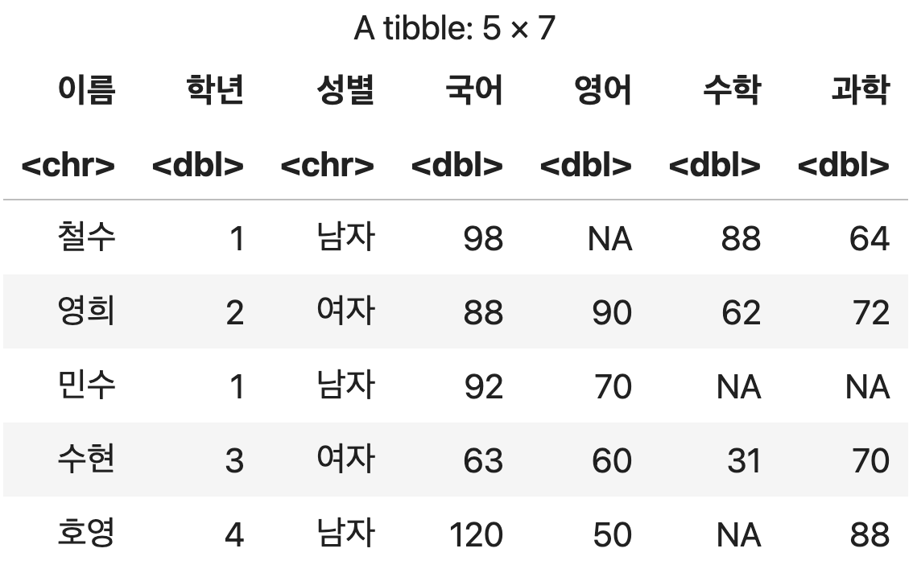</div>

---
layout: section
---

# #02. 행,열의 순서, 이름 변경

---

### 1) 데이터 순서 변경 구문형식

```r
생성될복사본 <- 원본[행순서 , 열순서]
```

---

### 2) 열 순서 변경하기 — 인덱스 번호로 변경하기

행의 위치를 비워두고 열에 대한 정보만 명시한다.

각 컬럼들에게는 1부터 카운트되는 일련번호가 부여되는데 이를 인덱스 번호라고 한다.

이 번호를 재배치 하여 순서를 변경할 수 있다.

<div class="kicker">인덱스 번호를 사용하여 컬럼 순서 재배치 하기</div>

```r
성적표_순서변경1 <- 성적표[ , c(2, 1, 3, 4, 5, 6, 7)]
성적표_순서변경1
```

<div class="fill-img">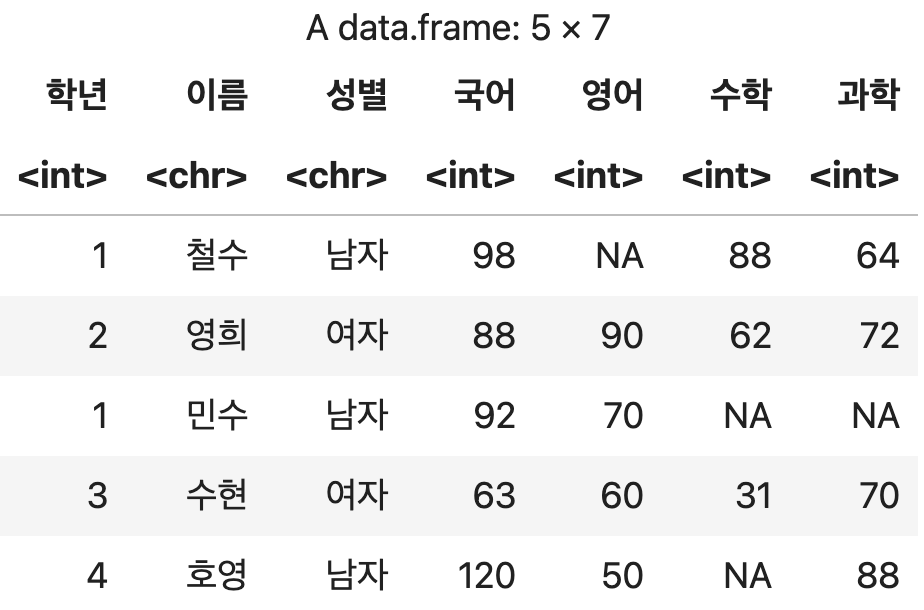</div>

---

### 2) 열 순서 변경하기 — 컬럼 이름으로 변경하기

변경할 순서에 맞게 컬럼 이름을 벡터로 설정한다.

<div class="kicker">컬럼 이름으로 순서 변경하기</div>

```r
성적표_순서변경2 <- 성적표[, c('학년', '성별', '이름', '국어', '수학', '영어', '과학')]
성적표_순서변경2
```

<div class="fill-img">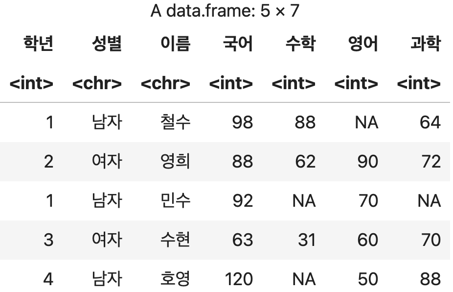</div>

---

### 2) 열 순서 변경하기 — 누락된 컬럼이 있는 경우

재배치될 항목의 이름 중 누락되는 항목은 생성 결과에서 제외된다.

필요한 컬럼만 추려내는 기능으로 이해할 수 있다.

<div class="kicker">이름, 국어, 수학 컬럼만 추출하기</div>

```r
성적표_순서변경3 <- 성적표[, c('이름', '국어', '수학')]
성적표_순서변경3
```

<div class="fill-img">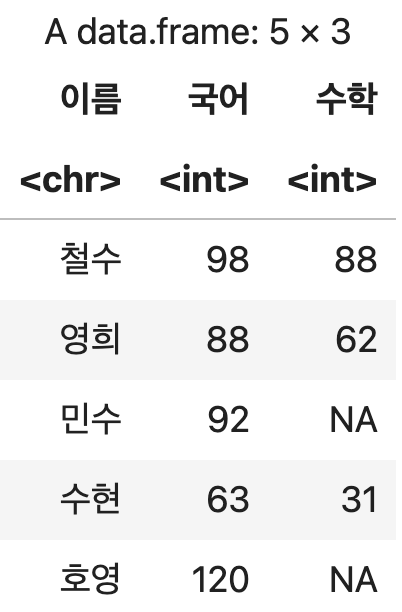</div>

---

### 3) 행 순서 변경하기 — 인덱스 번호로 변경하기

열에 대한 정보를 누락하고 행의 정보만 명시한다.

변경하고자 하는 행의 인덱스 번호를 재배치 한다.

컬럼의 경우와 마찬가지로 문자열로 된 인덱스 이름이 명시적으로 존재하는 경우에는 인덱스 이름으로도 변경 가능하다.

<div class="kicker">인덱스 번호를 활용한 행 순서 변경</div>

```r
성적표_순서변경4 <- 성적표[c(5, 4, 3, 2, 1), ]
성적표_순서변경4
```

<div class="fill-img">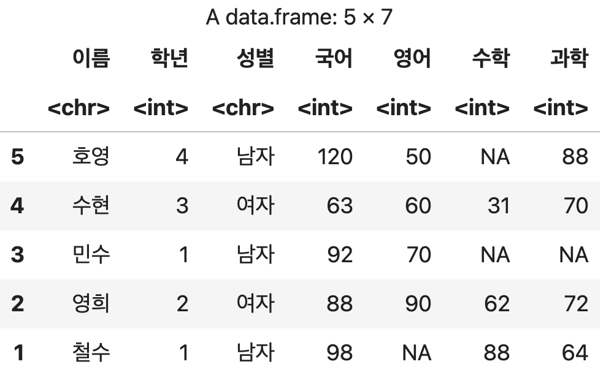</div>

---

### 4) 행,열 순서를 한번에 변경하기

행, 열에 대한 정보를 모두 명시한다.

<div class="kicker">행,열 순서 일괄 변경</div>

```r
성적표_순서변경5 <- 성적표[c(5, 4, 3, 2, 1),
                     c('학년','성별','이름', '국어', '수학', '영어', '과학')]
성적표_순서변경5
```

<div class="fill-img">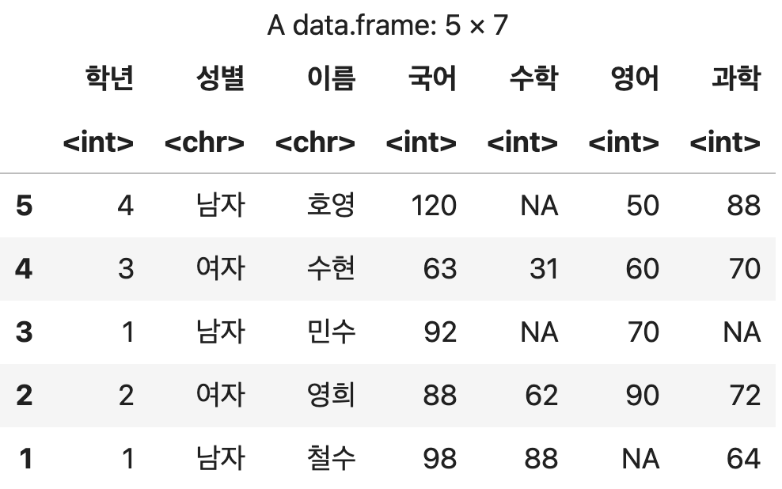</div>

---
layout: section
---

# #03. 컬럼, 인덱스 이름 변경하기

---

### 1) 컬럼 이름 변경하기

<div class="kicker">구문 형식</div>

```r
💡 생성될복사본 <- rename(원본, 새이름=원래이름, 새이름=원래이름, ...)
```

<div class="kicker">컬럼 이름 변경하기</div>

```r
성적표_이름변경1 <- rename(성적표, name=이름, kor=국어, math=수학)
성적표_이름변경1
```

<div class="fill-img">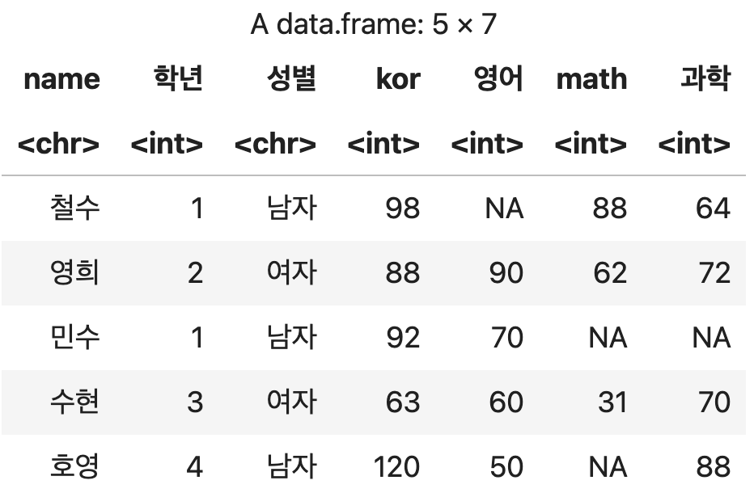</div>

---

### 2) 인덱스 이름 변경하기 — 특정 컬럼을 인덱스로 지정하기

외부에서 가져온 데이터들은 인덱스 이름이 사용되지 않고 모든 변수가 컬럼으로 생성되기 때문에 인덱스를 사용해야 할 상황이라면 특정 컬럼을 인덱스로 변환해야 한다.

`%>%` 연산자는 dplry 패키지에 의해서 사용 가능한 기능으로 여러 개의 함수를 연속적으로 사용할 수 있도록 한다.

```r
성적표_이름변경2 <- 성적표 %>% column_to_rownames('이름')
성적표_이름변경2
```

<div class="fill-img">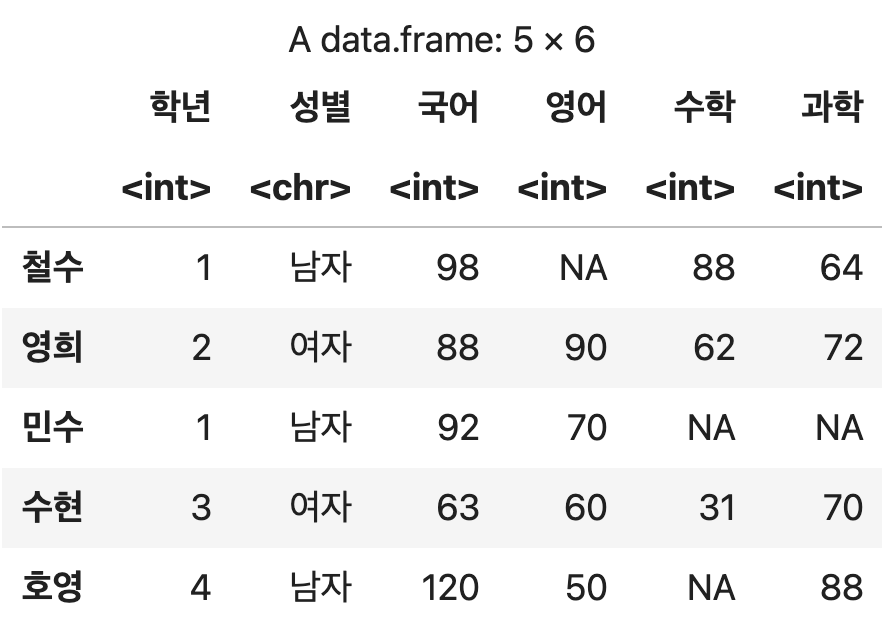</div>

---

### 인덱스 이름 변경하기

재배치될 순서에 맞게 백터로 구성하여 `rownames(데이터프레임)`에 대입한다.

다른 기능과 다르게 원본에 즉시 반영되기 때문에 원본을 유지해야 하는 경우 복사본을 만든 후 진행해야 한다.

```r
# 복사본 만들기
성적표_이름변경3 <- 성적표_이름변경2

# 인덱스 이름 변경
rownames(성적표_이름변경3) <- c('cs','yh','ms','sh','hy')
성적표_이름변경3
```

<div class="fill-img">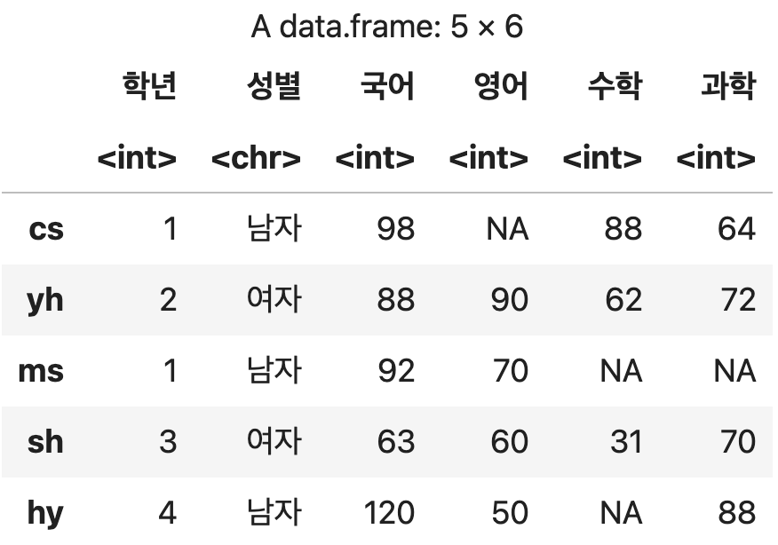</div>

---

### 인덱스를 컬럼으로 변경하기

`rownames_to_column()` 함수를 사용하면 인덱스를 컬럼으로 설정할 수 있다.

<div class="kicker">인덱스를 이름 컬럼으로 변경하기</div>

```r
성적표_이름변경4 <- 성적표_이름변경3 %>% rownames_to_column('이름')
성적표_이름변경4
```

<div class="fill-img">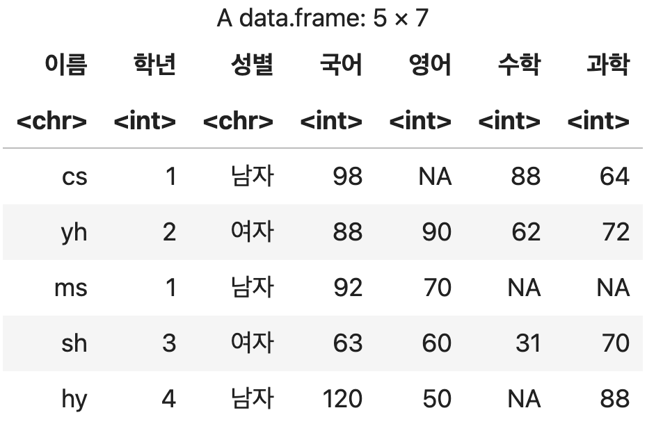</div>

---
layout: section
---

# #04. 데이터 정렬

---

### 1) 특정 변수를 기준으로 오름차순 정렬

`arrange()` 함수는 데이터 정렬을 수행한다.

<div class="kicker">국어점수를 기준으로 오름차순 정렬하기</div>

```r
국어점수정렬 <- 성적표 %>% arrange(국어)
국어점수정렬
```

<div class="fill-img">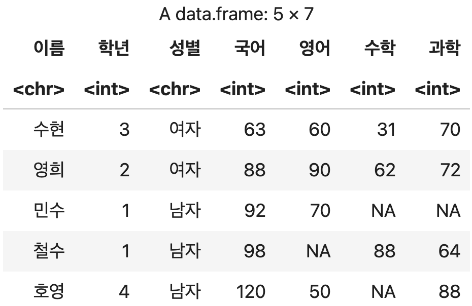</div>

---

### 2) 특정 변수를 기준으로 내림차순 정렬

정렬할 변수 이름에 `desc()` 함수를 적용한다.

<div class="kicker">수학점수를 기준으로 내림차순 정렬하기</div>

```r
수학점수정렬 <- 성적표 %>% arrange(desc(수학))
수학점수정렬
```

<div class="fill-img">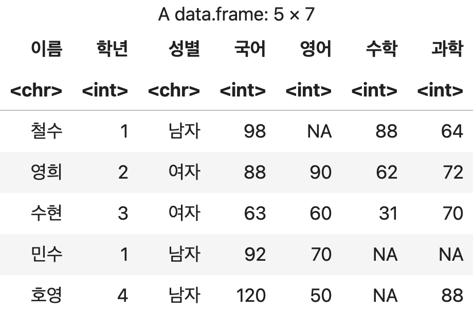</div>

---

### 3) 두 개 이상의 정렬 기준 정하기

첫 번째 정렬 기준의 값이 동일할 경우 두 번째 기준을 사용해서 정렬한다.

<div class="kicker">복수 컬럼 기준 정렬</div>

```r
# 국어 점수가 동일할 경우 수학점수 역순으로 정렬
정렬df <- 성적표 %>% arrange(국어, desc(수학))
정렬df
```

<div class="fill-img">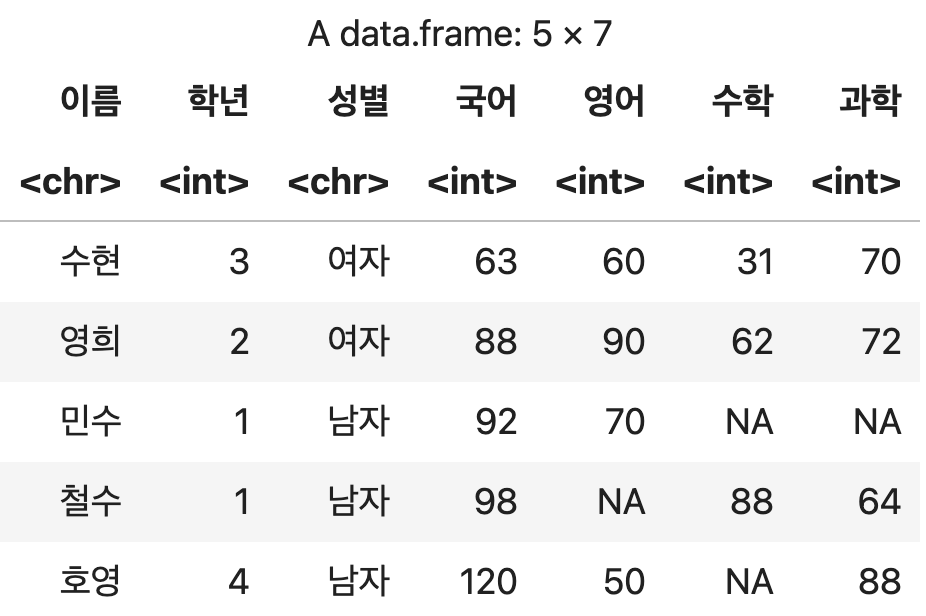</div>

---
layout: section
---

# #05. 데이터 검색/추출

---

### 1) 행단위 검색

조건에 맞는 행을 걸러내기 위해 `filter()` 함수를 사용한다.

<div class="kicker">성적표에서 국어 점수가 90점 초과인 데이터만 추출하기.</div>

```r
df <- 성적표 %>% filter(국어 > 90)
df
```

<div class="fill-img">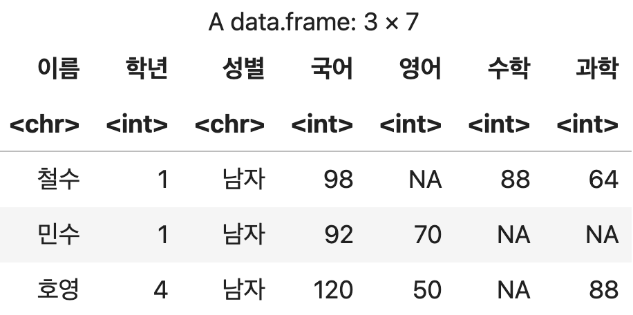</div>

---
class: tbl-wrap
---

### 2) filter() 함수의 연산자

| 연산자      | 종류                                                                                  |
| ----------- | ------------------------------------------------------------------------------------- |
| 비교 연산자 | `<`, `<=`, `>`, `>=`, `==`, `!=`                                                      |
| 산술연산자  | `+`, ``, ``, `/`<br/>제곱: `^`, `*`<br/>나눗셈의 몫: `%/%`<br/>나눗셈의 나머지 : `%%` |
| 논리 연산자 | 또는: `                                                                               | `<br/>그리고 : `&`<br/>매칭 확인 : `%in%` |

---

### 영어와 과학이 모두 70 이상인 경우

```r
df <- 성적표 %>% filter(영어 >= 70 & 과학 >= 70)
df
```

<div class="fill-img">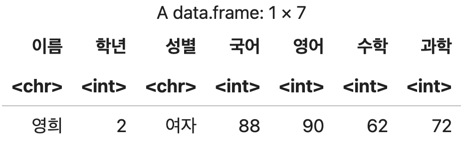</div>

---

### `%in%` 연산자를 사용하여 여러 개의 값 중에서 하나 이상 일치하는 데이터 추출

```r
# 학년 == 2 | 학년 == 3 과 같은 의미
df <- 성적표 %>% filter(학년 %in% c(2, 3))
df
```

<div class="fill-img">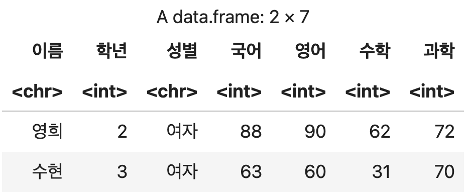</div>

---

### 3) 열단위 추출

데이터에 들어 있는 수많은 변수(열) 중 일부 변수만 추출하고자 할 때 `select()` 함수를 사용한다.

두 개 이상의 변수를 추출하고자 하는 경우 `select()` 함수를 호출하면서 추출하고자 하는 컬럼 이름을 콤마(`,`)로 구분하여 나열한다.

<div class="kicker">열 단위로 특정 변수만 추출하기</div>

```r
국어점수 <- 성적표 %>% select(국어)
국어점수
```

<div class="fill-img">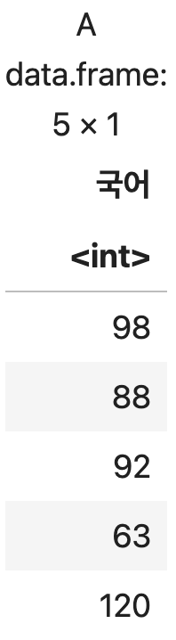</div>

---

### 두 개 이상의 변수 추출하기

```r
df <- 성적표 %>% select(국어, 수학)
df
```

<div class="fill-img">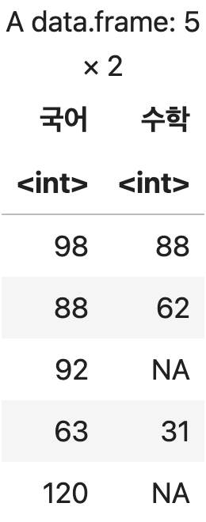</div>

---

### 특정 항목만 제외하고 추출하기

`-` 연산자를 변수명 앞에 적용한다.

두 가지 이상의 항목을 제외해야 하는 경우 `,`로 구분하여 `-`연산자가 적용된 변수명 명시한다.

<div class="kicker">과학 점수를 제외하고 추출하기</div>

```r
df <- 성적표 %>% select(-과학)
df
```

<div class="fill-img">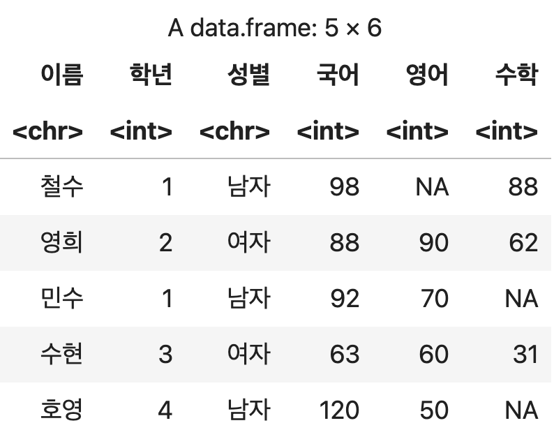</div>

---

### 특정 항목만 제외하고 추출하기 (계속)

<div class="kicker">영어, 과학을 제외하고 추출하기</div>

```r
df <- 성적표 %>% select(-영어, -과학)
df
```

<div class="fill-img">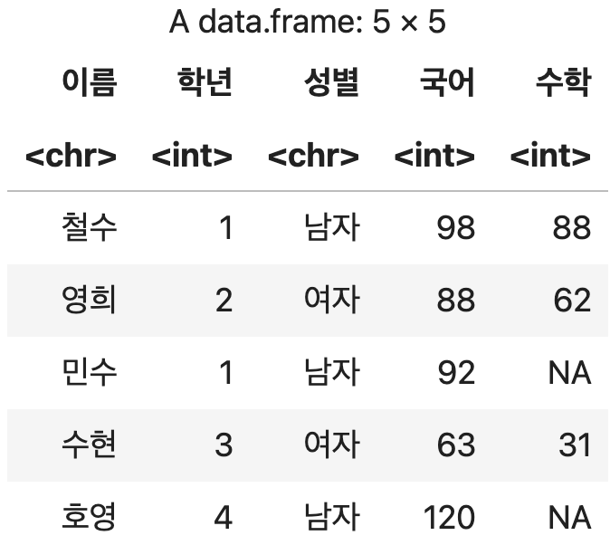</div>

---
layout: section
---

# #05. 행, 열 추가

---

### 1) 행단위 추가 — 새로운 행 추가하기

아래 예제들은 성적표 라는 원본 데이터 프레임을 반복적으로 사용하므로 추가되는 행들에 대한 결과가 누적되지는 않는다.

추가하고자 하는 행을 백터로 구성하여 `rbind(원본, 추가될행)` 형태로 처리하여 결과가 적용된 복사본을 반환받는다.

<div class="kicker">영민 학생의 성적 추가하기</div>

```r
df <- rbind(성적표, c('영민', 3, '남자', 90, 80, 90, 62))
df
```

<div class="fill-img">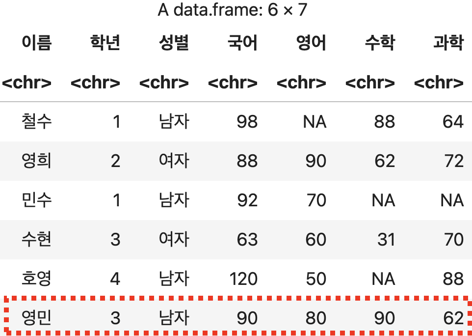</div>

---

### 추가되는 값들이 원본 데이터프레임의 열보다 적은 경우

값이 부족한 컬럼은 데이터가 처음부터 순환되어 적용된다.

<div class="kicker">혜민 학생의 성적을 정보가 부족한 상태로 추가하기</div>

```r
df <- rbind(성적표, c('혜민', 2, '여자', 90, 80))
df
```

<div class="fill-img">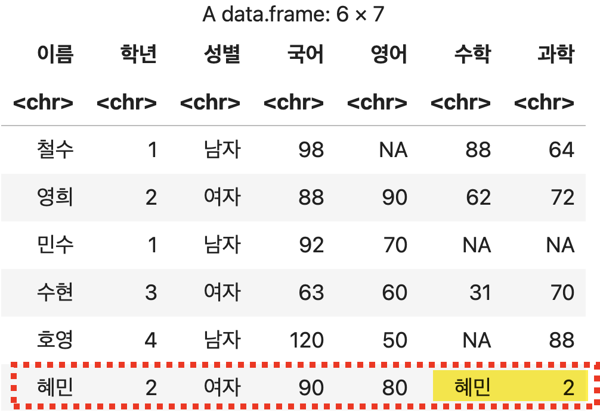</div>

---

### 추가되는 값들이 원본 데이터프레임의 열보다 많은 경우

남는 데이터는 버려진다.

<div class="kicker">호철 학생의 정보를 초과되는 정보로 추가하기</div>

```r
df <- rbind(성적표, c('호철', 3, '남자', 90, 80, 70, 60, 50, 40, 30))
df
```

<div class="fill-img">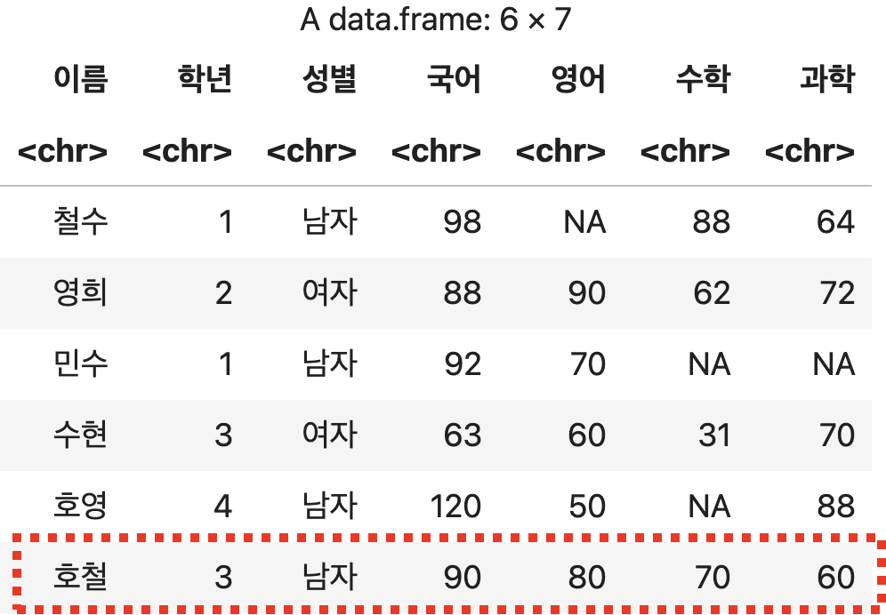</div>

---

### 여러 줄을 추가하는 경우

추가될 행을 구성하는 백터들을 콤마(`,`)로 구분하여 나열한다.

<div class="kicker">학생 세명의 데이터 추가하기</div>

```r
df <- rbind(성적표, c('영민', 3, '남자', 90, 80, 90, 62),
                  c('혜민', 2, '여자', 90, 80, 92, 87),
                  c('호철', 3, '남자', 90, 80, 70, 60))
df
```

<div class="fill-img">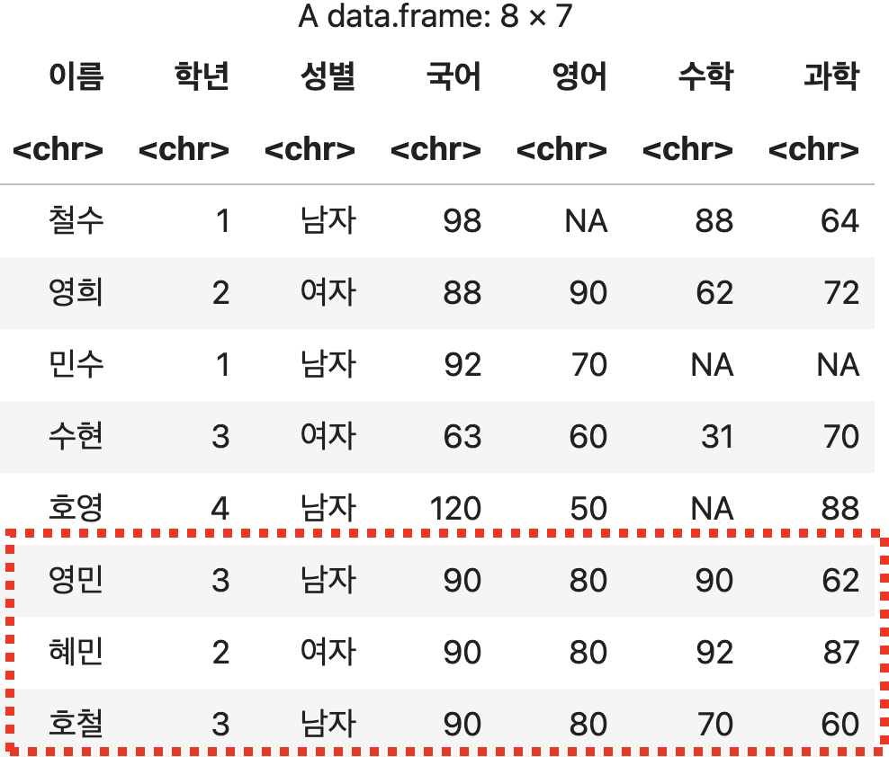</div>

---

### 2) 열 단위 추가 — 개별값 지정하기

원본에 즉시 반영되므로 원본을 보관해야 할 경우 별도의 복사본을 생성하고 진행한다.

`데이터프레임이름$새로운컬럼 <- 추가할백터` 형식으로 처리한다.

추가되는 값의 수가 데이터프레임의 행의 수 보다 적은 경우 에러가 발생한다.

<div class="kicker">역사 변수 추가하기</div>

```r
# 복사본 만들기
성적표copy <- 성적표
성적표copy$역사 <- c(90, 43, 67, 86, 34)
성적표copy
```

<div class="fill-img">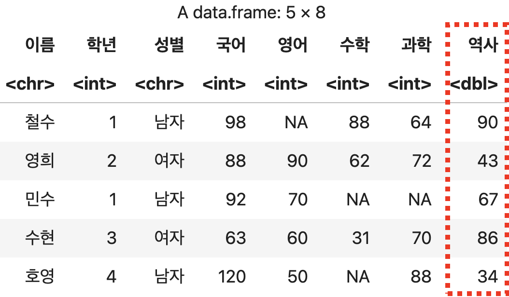</div>

---

### 단일값 추가하기

스칼라 값을 추가할 경우 모든 행에 대해 일괄 적용된다.

<div class="kicker">미술 점수를 모든 학생에게 일괄 적용하기</div>

```r
성적표copy <- 성적표
성적표copy$미술 <- 100
성적표copy
```

<div class="fill-img">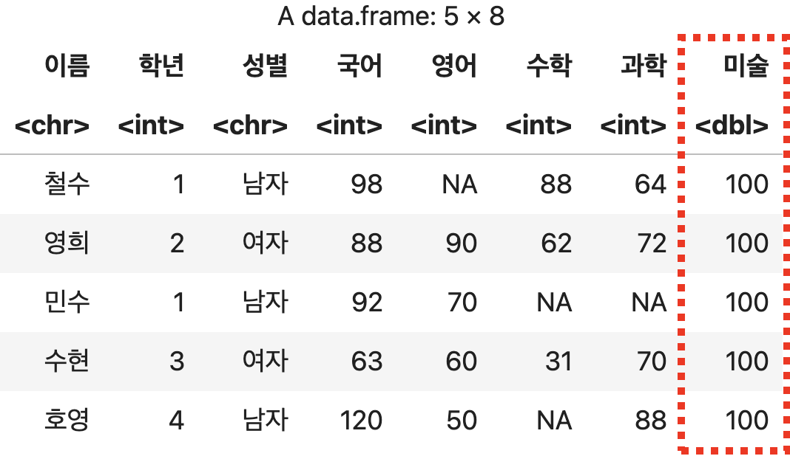</div>

---

### 단일 컬럼 추가하기

<div class="kicker">3) transform(데이터프레임, 추가할컬럼) 함수를 사용한 열 추가</div>

처리 결과가 적용된 복사본이 생성되므로 별도의 복사본을 만들 필요가 없다.

추가되는 값이 현재 있는 행의 수 보다 많거나 적을 경우 에러가 발생한다.

<div class="kicker">학생별로 역사 점수 추가하기</div>

```r
df <- transform(성적표, 역사=c(90, 43, 67, 86, 34))
df
```

<div class="fill-img">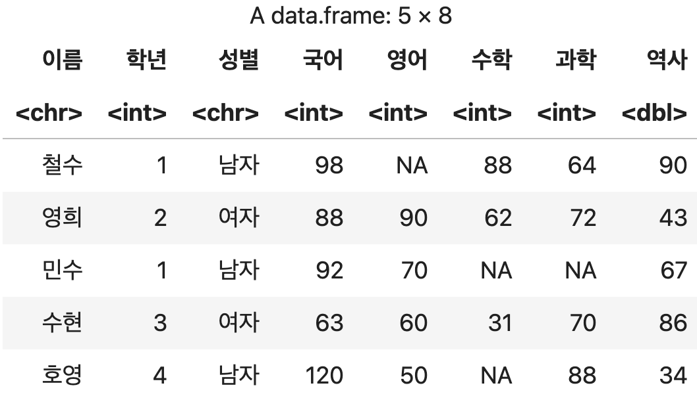</div>

---

### 여러 컬럼 추가하기

추가할 컬럼의 정보들을 콤마(`,`)로 구분한다.

<div class="kicker">역사, 철학 점수 추가하기</div>

```r
df <- transform(성적표, 역사=c(90, 43, 67, 86, 34), 음악=100,
                철학=c(72, 88, 90, 76, 81))
df
```

<div class="fill-img">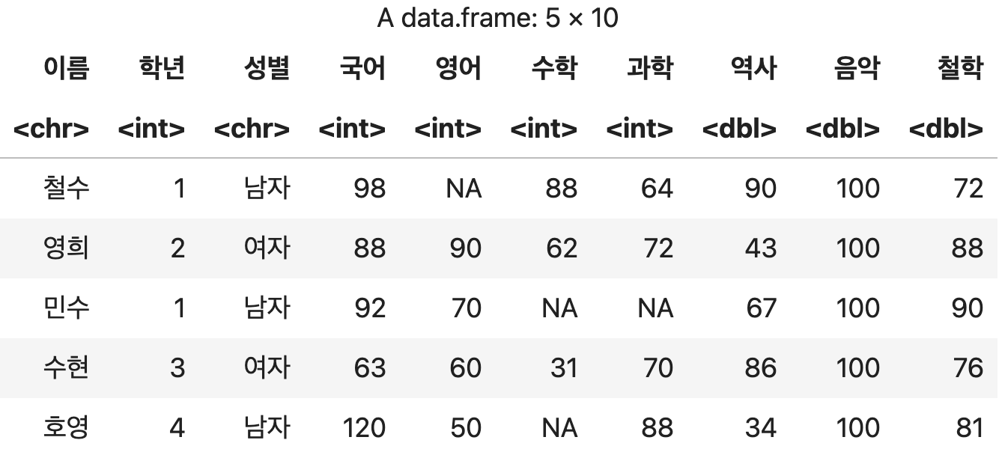</div>

---

### 3) 파생변수 추가하기

`mutate()` 함수를 사용하여 기존의 데이터를 기반으로 계산되어진 새로운 컬럼을 추가할 수 있다.

<div class="kicker">기존 데이터에 파생변수 추가하기</div>

mutate()에 새로 만들 변수명과 변수를 만들 때 사용할 공식을 지정한다.

결측치(NA)가 있는 행은 계산할 수 없다.

<div class="kicker">총점 계산하기</div>

```r
df <- 성적표 %>% mutate(총점=국어+영어+수학+과학)
df
```

<div class="fill-img">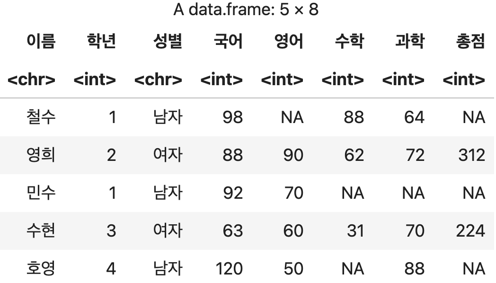</div>

---

### 두 개 이상의 파생변수 만들기

`mutate()`함수에서 콤마(`,`)로 구분하여 일괄 처리 할 수 있다.

<div class="kicker">총점과 평균 계산하기</div>

```r
df <- 성적표 %>% mutate(총점=국어+영어+수학+과학, 평균=총점/4)
df
```

<div class="fill-img">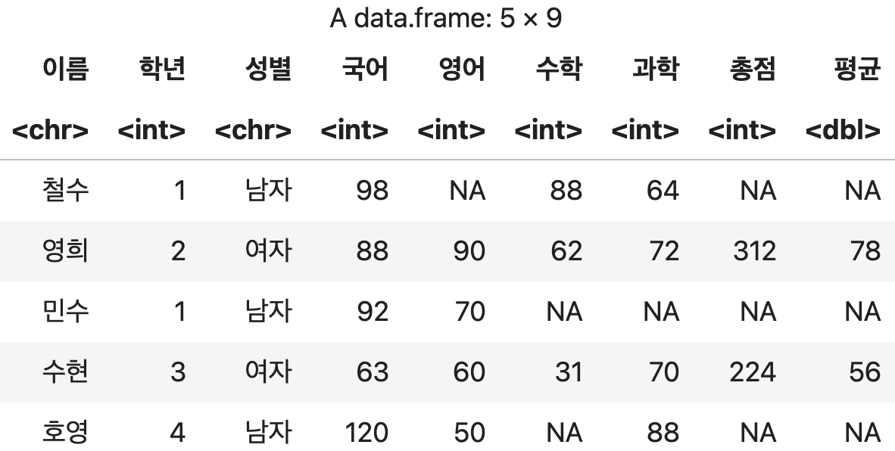</div>

---

### 4) dplyr 패키지의 chain 기능 활용하기

- `%>%` 연산자를 연속적으로 사용하여 여러 개의 함수를 연결해서 사용할 수 있다.
- 추가된 변수는 다른 함수에서 즉시 연결해서 사용 가능하다.
- 아래의 예시는 `mutate()`에서 생성한 파생변수를 `arrange()`에서 받아서 사용하고 있다.

> 주의사항 : 코드가 길어서 중간에 줄바꿈 할 경우, `%>%` 연산자는 반드시 한 행의 끝에 명시해야 함.

---

### chain 기능을 활용하여 총점과 평균 계산 후 총점 순으로 정렬하기

```r
df <- 성적표 %>% mutate(총점=국어+영어+수학+과학, 평균=총점/4) %>% arrange(총점)
df
```

<div class="fill-img">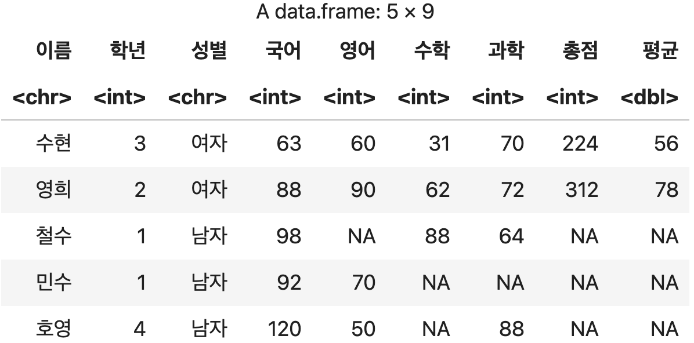</div>

---

### 조건에 따른 값 선택하기

- `ifelse(조건, A, B)` 함수는 조건이 참인 경우 A를, 거짓인 경우 B를 반환한다.
- `mutate()`함수에서 `ifelse()`함수의 결과를 생성하도록 지정한다.
- `mutate()` 함수끼리 `%>%` 연산자를 사용하여 chain 기능을 사용할 수 있다.

<div class="kicker">평균에 따른 합격 여부 판정하기</div>

```r
df <- 성적표 %>%
        mutate(총점=국어+영어+수학+과학, 평균=총점/4) %>%
        mutate(결과=ifelse(평균 >= 70, '합격', '불합격'))
df
```

<div class="fill-img">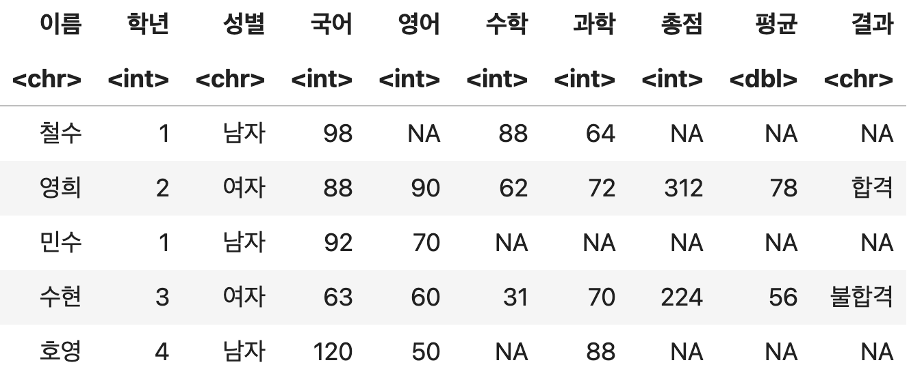</div>

---

### 여러 조건 중에서 선택적으로 값을 추가하기

`case_when()` 함수를 사용하여 여러 조건 중에서 선택적으로 값을 지정할 수 있다.

<div class="kicker">학점 계산하기</div>

```r
df <- 성적표 %>%
        mutate(총점=국어+영어+수학+과학, 평균=총점/4) %>%
        mutate(결과=ifelse(평균 >= 70, '합격', '불합격')) %>%
        mutate(학점=case_when(평균 > 90 ~ "A",
                             평균 > 80 ~ "B",
                             평균 > 70 ~ "C",
                             TRUE ~ "F"))
df
```

<div class="fill-img">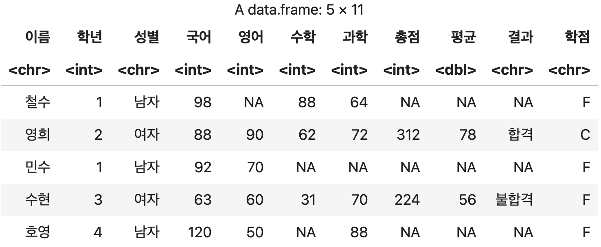</div>

---
layout: section
---

# #06. 행, 열 삭제

---

### 1) 행 삭제하기

`데이터프레임이름[!(삭제조건), ]` 형식으로 연산을 수행한 결과를 반환받는다.

> 느낌표와 콤마 주의

<div class="kicker">국어점수가 100점을 초과하는 행 삭제하기</div>

```r
df <- 성적표[!(성적표$국어 > 100 ), ]
df
```

<div class="fill-img">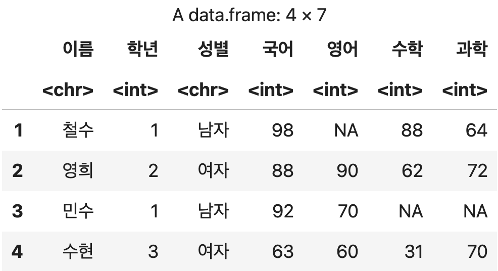</div>

---

### 2) 열 삭제하기 — 컬럼 위치에 따른 삭제

삭제할 컬럼의 위치를 담는 백터에 대해 `-`연산자 를 적용.

컬럼의 이름이 아닌 1부터 시작하는 인덱스 번호를 사용하여 삭제해야 한다.

<div class="kicker">1, 2, 3번째 열 삭제하기</div>

```r
df <- 성적표[ , -c(1, 2, 3)]
df
```

<div class="fill-img">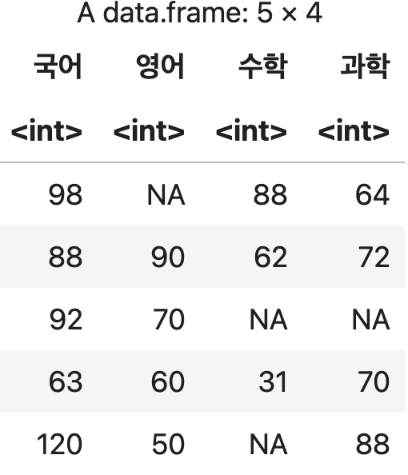</div>

---

### 컬럼 이름에 의한 삭제

`names(데이터프레임)`에 의해 컬럼의 이름을 반환받아 이 중에서 삭제 대상을 의미하는 벡터와 겹치지 않는 것들만 추려낸다.

> 엄밀히 말하면 삭제는 아니고, 지정한 조건에 맞지 않는 것들만 추려내는 형태.

<div class="kicker">성적표에서 학년과 성별을 제외하고 추출하기</div>

```r
drop_target <- c('학년', '성별')
df <- 성적표[ , !(names(성적표) %in% drop_target)]
df
```

<div class="fill-img">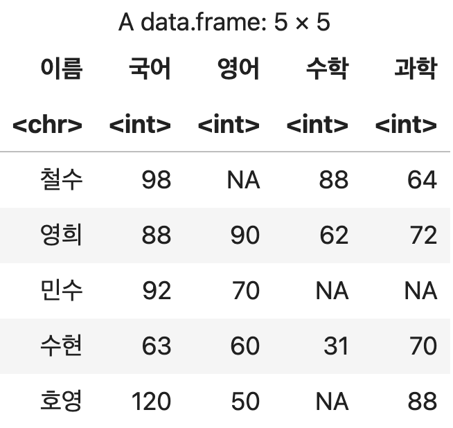</div>

---
layout: section
---

# #07. 두 개 이상의 데이터 프레임 병합하기

---

### 1) 열 단위로 결합하기

두 개의 데이터 프레임을 결합하는 기능

```r
💡 변수 <- left_join(프레임1, 프레임2, … 프레임n, by="기준열")
```

- 나열된 프레임들을 by속성에 설정한 열이 동일한 값들을 기준으로 합친다.
- 데이터를 가로로 합치는 것은 기존 데이터에 변수(열)을 추가한다고 볼 수 있다.

---

### 첫 번째 샘플 데이터 준비

```r
학생정보 <- data.frame(학생=c("철수", "영희", "호영"),
                     학년=c(1, 1, 3),
                     성별=c("남자","여자", "남자"))
학생정보
```

<div class="fill-img">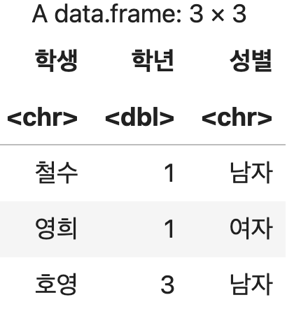</div>

---

### 두 번째 샘플 데이터 준비

```r
성적 <- data.frame(이름=c("영희", "민수", "수현"),
                  국어=c(88, 92, 63),
                  영어=c(90, 70, 60),
                  수학=c(62, NA, 31),
                  과학=c(72, NA, 70))
성적
```

<div class="fill-img">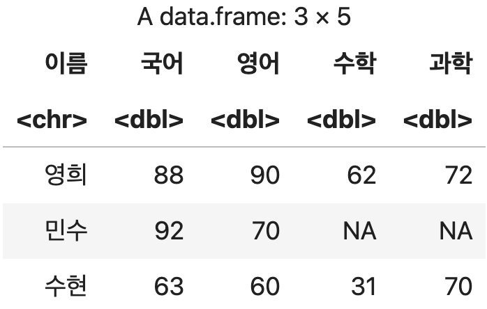</div>

---

### 왼쪽 데이터를 기준으로 결합하기 (left_join)

왼쪽에 지정된 데이터프레임(학생정보)에 대한 전체 데이터를 유지하고, 오른쪽 데이터(성적)에서 이름 열을 기준으로 매칭되는 데이터들을 찾아 결합한다.

즉, 아래와 같은 집합의 개념이다. 기준열간의 데이터가 동일하지 않으면 경고메시지가 표시된다. (무시)

<div class="fill-img"><div class="fill-in">
<figure><div class="kicker">left_join 도식</div><div class="pic">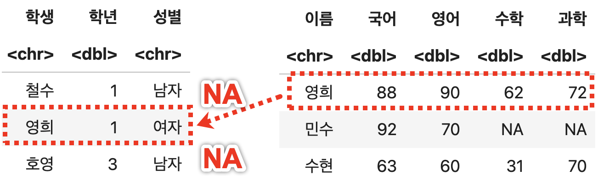</div></figure>
<figure><div class="kicker">집합의 개념</div><div class="pic"></div></figure>
</div></div>

---

### 왼쪽 기준 결합 (left_join)

```r
left_join(학생정보, 성적, by=c("학생" = "이름"))
```

<div class="fill-img">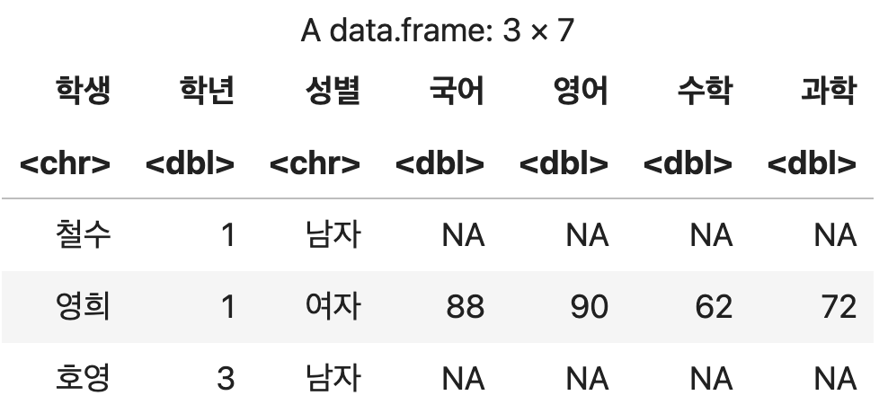</div>

---

### 오른쪽 데이터를 기준으로 결합하기 (right_join)

오른쪽에 지정된 데이터프레임(성적)에 대한 전체 데이터를 유지하고, 왼쪽 데이터(학생정보)에서 이름 열을 기준으로 매칭되는 데이터들을 찾아 결합한다.

<div class="fill-img"><div class="fill-in">
<figure><div class="kicker">right_join 도식</div><div class="pic">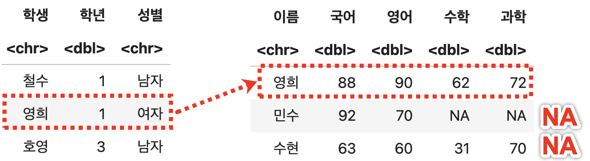</div></figure>
<figure><div class="kicker">집합의 개념</div><div class="pic">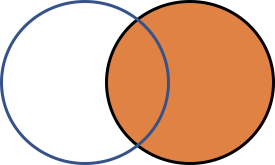</div></figure>
</div></div>

---

### 오른쪽 기준 결합 (right_join)

```r
right_join(학생정보, 성적, by=c("학생" = "이름"))
```

<div class="fill-img">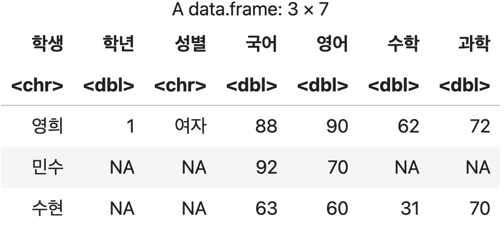</div>

---

### 전체 데이터 결합하기 (full_join)

양쪽의 데이터를 교차로 결합한다.

<div class="fill-img">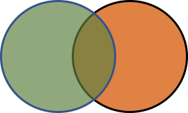</div>

---

### 데이터 교차 결합 (합집합)

```r
full_join(학생정보, 성적, by=c("학생" = "이름"))
```

<div class="fill-img">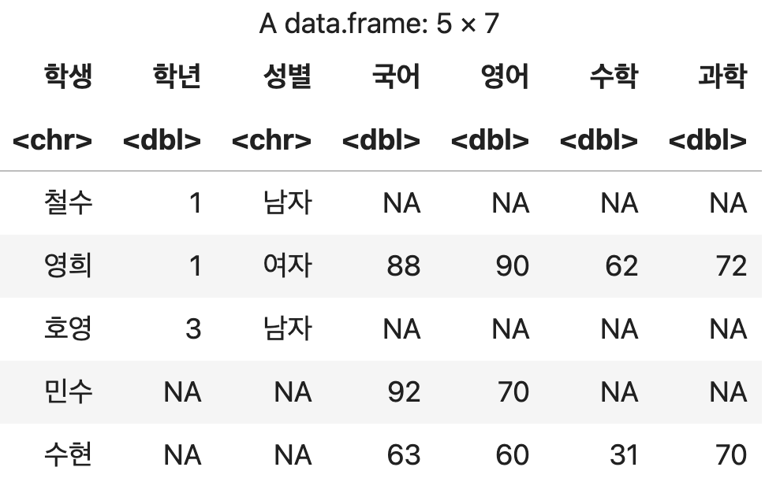</div>

---

### 기준열의 데이터가 매칭되는 것만 결합하기

양쪽에서 기준열의 값이 공통적으로 존재하는 행만 결합

<div class="fill-img"><div class="fill-in">
<figure><div class="kicker">inner_join 도식</div><div class="pic">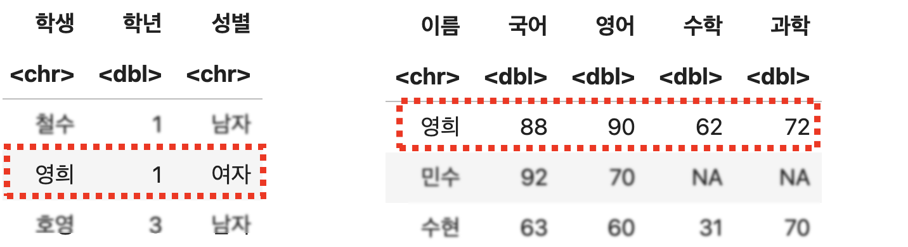</div></figure>
<figure><div class="kicker">집합의 개념</div><div class="pic"></div></figure>
</div></div>

---

### 교차로 매칭되는 데이터만 결합하기

```r
inner_join(학생정보, 성적, by=c("학생" = "이름"))
```

<div class="fill-img">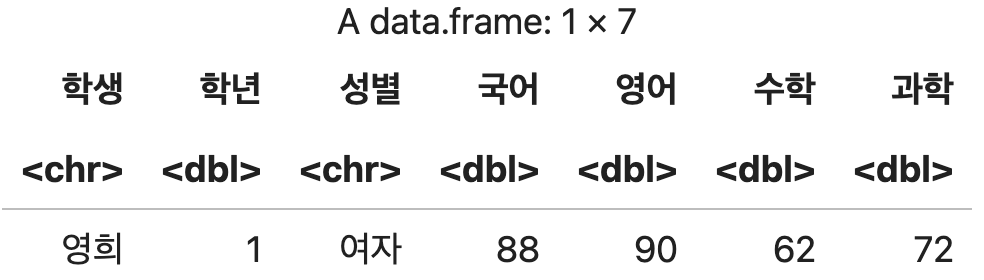</div>

---

### semi_join

양쪽에서 기준열의 값이 공통적으로 존재하는 행만 결합하되 왼쪽 데이터의 열만 갖는다.

결합이라기 보다는 왼쪽 데이터에서 오른쪽과 겹치는 항목만 걸러낸다고 보는 것이 맞다.

<div class="fill-img">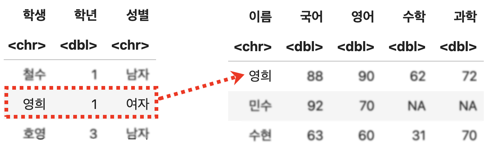</div>

---

### 왼쪽에서 오른쪽과 겹치는 항목 걸러내기

```r
semi_join(학생정보, 성적, by=c("학생" = "이름"))
```

<div class="fill-img">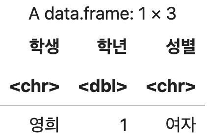</div>

---

### anti_join

`semi_join`의 반대 기능.

왼쪽 데이터에서 오른쪽 데이터와 겹치지 않는 행만 걸러낸다.

<div class="fill-img">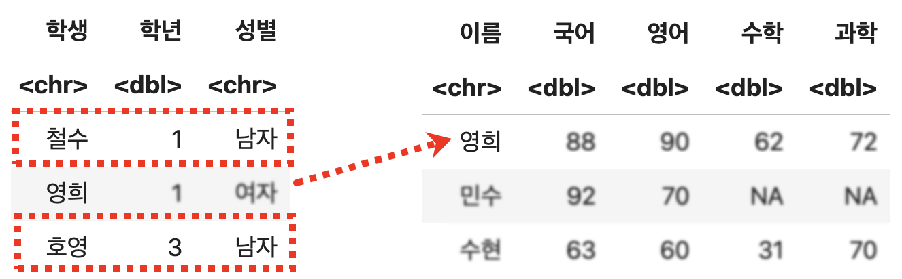</div>

---

### 오른쪽 데이터와 겹치는 항목만 걸러내기

```r
anti_join(학생정보, 성적, by=c("학생" = "이름"))
```

<div class="fill-img"></div>

---

### 2) 행단위로 결합하기 — 첫 번째 샘플데이터 준비

```r
성적표1 <- data.frame(이름=c("철수", "영희", "민수"),
                    학년=c(1, 1, 2),
                    성별=c("남자","여자", "남자"),
                    국어=c(98, 88, 92),
                    영어=c(NA, 90, 70),
                    수학=c(88, 62, NA))
성적표1
```

<div class="fill-img"></div>

---

### 두 번째 샘플 데이터 준비

```r
성적표2 <- data.frame(이름=c("철수", "수현", "호영"),
                    학년=c(1, 2, 3),
                    성별=c("남자", "여자", "남자"),
                    국어=c(98, 63, 120),
                    영어=c(NA, 60, 50),
                    과학=c(64, 70, 88))
성적표2
```

<div class="fill-img"></div>

---

### 행 단위로 데이터 결합하기

양쪽의 DataFrmae에서 중첩되지 않는 열은 결측치(NA)로 처리되어 병합된다.

단순한 병합처리이기 때문에 데이터의 중복 여부는 검사하지 않는다.

<div class="kicker">행 단위 단순 병합</div>

```r
bind_rows(성적표1, 성적표2)
```

<div class="fill-img"></div>
