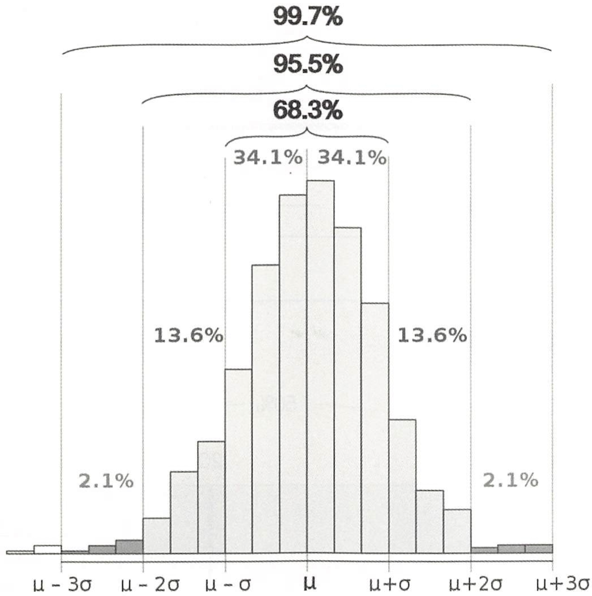
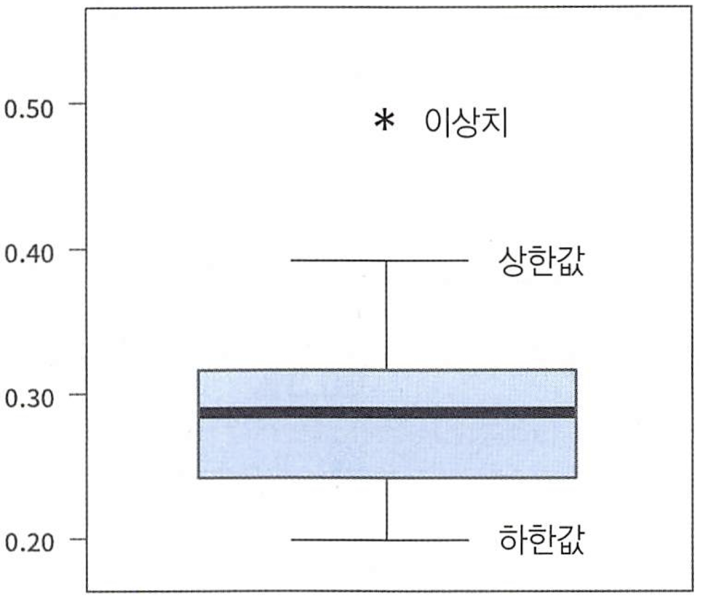
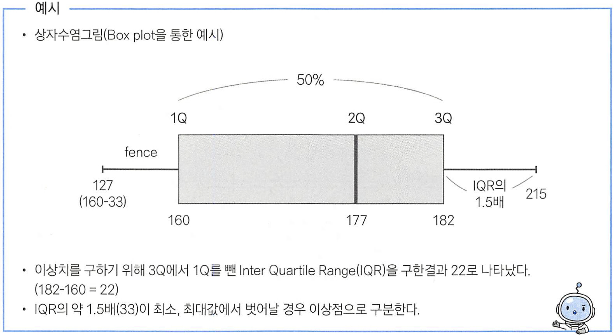
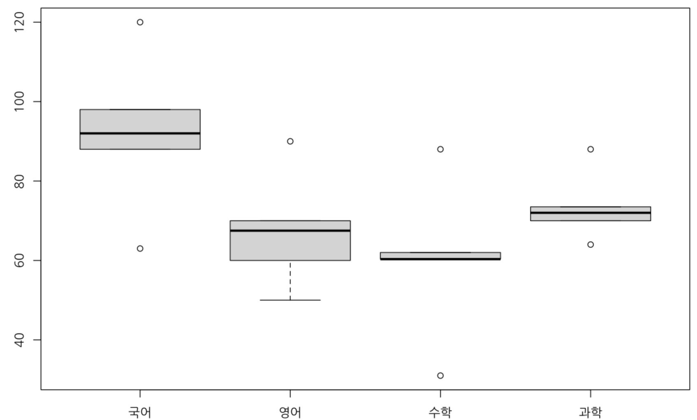
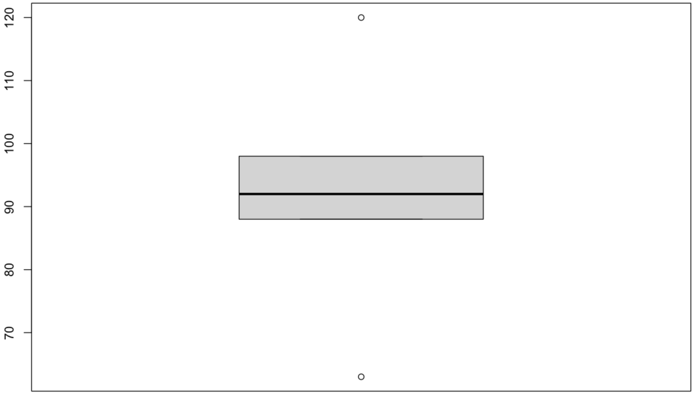
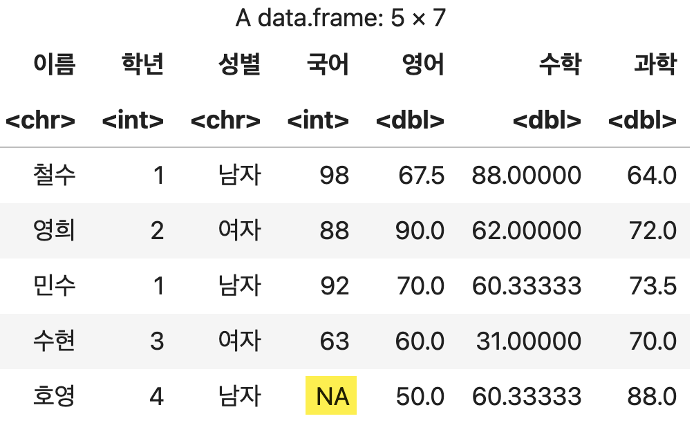
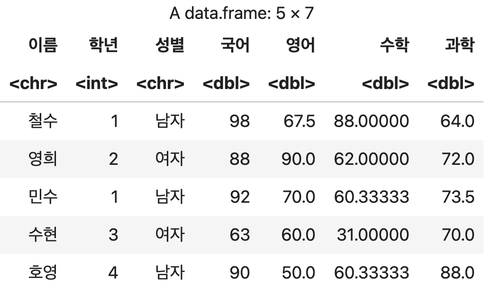

# 데이터 정제 (2) - 이상치

<p class="sub">R 데이터 분석 · 25강</p>

---
layout: section
---

# #01. 이상치의 이해

---

### 1) 이상치란?

- 의도하지 않게 잘못 입력한 경우 (Bad data)
- 의도하지 않게 입력되었으나 분석 목적에 부합되지 않아 제거해야 하는 경우 (Bad data)
- 의도하지 않은 현상이지만 분석에 포함해야 하는 경우
- 의도된 이상값 (fraud, 불량)인 경우
- 이상값을 꼭 제거해야 하는 것은 아니기 때문에 분석의 목적이나 종류에 따라 적절한 판단이 필요하다 .

---

### 2) 극단치

이상치의 한 종류.

오류는 아니지만 굉장히 드물게 발생하는 극단적인 값.

<Callout kind="eli5">

ex) 몸무게 변수에 200kg 이상의 값이 있다면, 존재할 가능성은 있지만 굉장히 드문 경우이므로 극단치라 볼 수 있다.

</Callout>

---
layout: section
---

# #02. 이상치 인식과 처리

---

### 1) 이상치의 인식 방법

극단치 제거를 위해 먼저 어디까지를 정상 범위로 볼 것인가를 정해야 한다.

<div class="kicker">논리적으로 판단하여 정하기</div>

성인의 몸무게가 40~150kg를 벗어나는 경우는 상당히 드물 것으로 판단하고, 이 범위를 벗어나면 극단치로 간주하는 것이다.

---

### 통계적인 기준을 이용하기 : ESD (Extreme Studentized Deviation)

상하위 `0.3%` 또는 `+-3` 표준 편차에 해당할 만큼 극단적으로 크거나 작으면 극단치로 간주하는 방법

$기하평균 - 2.5 x 표준편차 < data < 기하평균 + 2.5 x 표준편차$

<div class="fill-img"></div>

---

### 상자그림

- 중심에서 크게 벗어난 값을 극단치로 간주.
- 극단치가 원으로 표시된다.
- $Q1 - 1.5 x (Q3 - Q1) < data < Q3 + 1.5 x ( Q3 - Q1)$를 벗어나는 데이터

---

### 2) 극단값 처리

| 이름                       | 태그                                        |
| -------------------------- | ------------------------------------------- |
| 기하평균을 이용한 제거     | geo_mean                                    |
| 하단，상단 `%` 이용한 제거 | 10% 절단(상하위 5%에 해당되는 데이터 제거 ) |

---

### 극단값 조정 방법

- 상한값과 하한값을 벗어나는 값들을 하한 , 상한값으로 바꾸어 활용

<div class="fill-img"></div>

---

### 극단값 조정 방법 (계속)

<div class="fill-img"></div>

---
layout: section
---

# #03. R에서 이상치 처리하기

---

### 1) 이상치가 존재하는지 확인하기

<div class="kicker">데이터 빈도표를 통한 확인</div>

값의 종류를 알 수 있기 때문에 이상치나 극단치를 확인할 수 있다.

아래 빈도표들을 보면 국어점수에서 120점에 대한 수치가 1건 표시됨을 알 수 있다.

```r
print(table(성적표$이름))
print(table(성적표$학년))
print(table(성적표$성별))
print(table(성적표$국어))
print(table(성적표$영어))
print(table(성적표$수학))
print(table(성적표$과학))
```

---

### 1) 이상치가 존재하는지 확인하기 (계속)

<Output>

```text
민수   수현   영희 철수  호영
   1    1    1    1    1

1 2 3 4
2 1 1 1

남자  여자
  3    2
```

</Output>

---

### 1) 이상치가 존재하는지 확인하기 (계속)

<Output>

```text
63  88  92  98 120
 1   1   1   1   1

50   60  67.5  70  90
 1    1     1   1   1

31   60.3333333333333   62  88
 1                  2    1   1

64   70   72 73.5   88
 1    1    1    1    1
```

</Output>

---

### 상자그림을 통한 확인

극단치가 원으로 표시된다.

```r
options(warn=-1)
par(family='NanumGothic')
options(repr.plot.width=10, repr.plot.height=7)
boxplot(성적표$국어, 성적표$영어, 성적표$수학, 성적표$과학,
        names=c('국어','영어', '수학', '과학'))
```

---

### 상자그림을 통한 확인 (계속)

<div class="fill-img"></div>

---

### 상자그림을 통한 확인 (계속)

도출된 극단치 중에서 어디까지를 극단치로 봐야 할 것인지에 대해 분석가의 주관이 필요하다.

- 국어 점수가 120점인 케이스는 100점을 만점으로 봤을 때 점수 입력 오류이므로 극단치가 맞다.
- 평균보다 점수가 낮거나 높더라도 정상적인 점수의 범주에 있다면 특별히 공부를 열심히 했거나 답안지를 밀려썼을 수 있기 때문에 극단치로 보아서는 안된다.

---

### `국어`점수에 대한 상자그림 상태 확인

`boxplot()$stats`는 상자그림에 대한 각 위치의 수치값을 표시한다.

극단치 자체를 표시하지는 않는다.

표시 순서대로 아래쪽 극단치 경계, 1사분위 수, 중앙값, 3사분위 수, 위쪽 극단치 경계를 의미한다.

```r
boxplot(성적표$국어)$stats
```

<Output>

```text
88  88  92  98  98
```

</Output>

---

### `국어`점수에 대한 상자그림 상태 확인 (계속)

<div class="fill-img"></div>

---

### 2) 이상치를 결측치로 변환하기

<div class="kicker">상자그림을 통해 이상치의 위치와 범위를 파악하고 결측치로 대체</div>

국어점수의 위쪽 극단치 경계가 98점으로 표시되었으므로 98점보다 큰 데이터는 모두 극단치로 간주하고 결측치(NA)로 대체한다.

```r
# 원본을 유지하기 위해 복사본을 하나 만들고 진행
결측치제거 <- 성적표

결측치제거$국어 <- ifelse(결측치제거$국어 > 98, NA, 결측치제거$국어)
결측치제거
```

---

### 2) 이상치를 결측치로 변환하기 (계속)

<div class="fill-img"></div>

---

### 결측치로 처리된 이상치를 다른 통계적 산출 값으로 대체

결측치 대체법을 적용하여 처리한다. 아래 코드는 결측치를 중앙값으로 대체하고 있다.

```r
결측치제거$국어[is.na(결측치제거$국어)] <- median(결측치제거$국어, na.rm=TRUE)
결측치제거
```

---

### 결측치로 처리된 이상치를 다른 통계적 산출 값으로 대체 (계속)

<div class="fill-img"></div>
