# 회귀분석

<p class="sub">R 데이터 분석 · 30강</p>

---
layout: section
---

# #01. 회귀분석(Regression analysis)의 이해

---

### 1) 회귀분석의 의미

- 하나나 그 이상의 독립변수들이 종속변수에 미치는 영향을 추정할 수 있는 통계기법.
- 독립변수 X(설명변수)에 대하여 종속변수 Y(반응변수)들 사이의 관계를 수학적 모형을 이용하여 규명하는 것.

<Callout kind="eli5">

`y = f(x)` 일 때, 함수 `f` 를 규명하여 독립적인 값 x에 따라 y가 어떻게 변화하는지를 예측하는 것

</Callout>

- 규명된 함수식을 이용하여 설명변수들의 변화로부터 종속변수의 변화를 예측하는 분석이다.
- 변수들 사이의 인과관계를 밝히고 모형을 적합하여 관심있는 변수를 예측하거나 추론하기 위한 분석방법이다 .
- 독립변수의 개수가 하나이면 단순선형회귀분석 , 독립변수의 개수가 두 개 이상이면 다중선형 회귀분석으로 분석할 수 있다 .

---

### 2) 회귀분석의 변수

<div class="kicker">

영향을 받는 변수 ($y$)

</div>

반응변수 (response variable), 종속변수 (dependent variable), 결과변수(outcome variable)

<div class="kicker">

영향을 주는 변수 ($x$)

</div>

설명변수 (explanatory variable), 독립변수 (independent variable), 예측변수 (predictor variable)

---

### 3) 회귀분석 예시 — 키(Height)에 따른 몸무게(Weight)

$$
Y(weight) = a + b * X(height)
$$

<Callout kind="eli5">

결국 Height에 따라 Weight가 결정되므로, Height는 독립변수, Weight는 종속변수.

</Callout>

<div class="fill-img">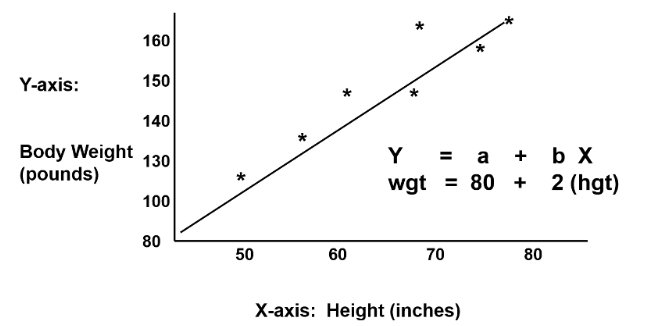</div>

---

### 남자들의 평균 키

- 남자의 평균 `Height`는 `175cm`라 하자.
- 세대를 거듭할때마다, `높은 Height + 낮은 Height` 사람들 혹은 `보통 Height + 보통 Height` 사람들이 다양하게 결혼하여 자녀를 낳을 것이다.
- 결국에는 남자들의 평균 `Height`는 `175cm`으로 회귀하려는 경향을 보일 것이다.

<div class="fill-img">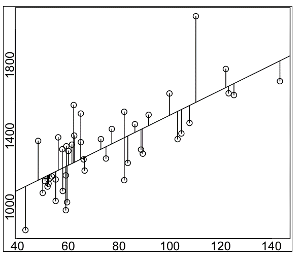</div>

---

### 남자들의 평균 키 (계속)

<Callout kind="eli5">

회귀의 기본 원리는 다음과 같이 선형 회귀모델의 직선과 실제 값 사이의 차를 뜻하는 residual error를 최소화 시키는 것이다.
위 예와 같이 적용한다면, X값에 따라 여러 Y값들이 나오겠지만, 결국에는 추론된 직선으로 회귀할 것이다.

</Callout>

---

### 4) 선형회귀분석의 가정

<div class="fill-img">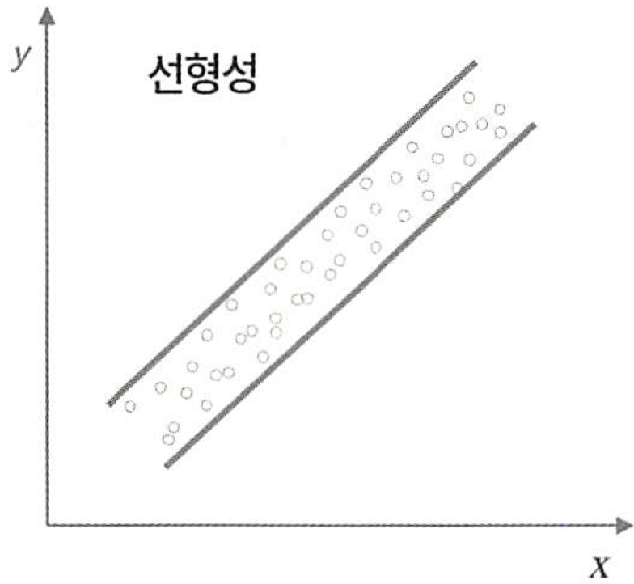</div>

---

### 선형성

- 입력변수와 출력변수의 관계가 선형이다 .(선형회귀분석에서 가장 중요한 가정)
- 선형회귀모형에서는 왼쪽의 그래프와 같이 설명 변수(x)와 반응변수(y)가 선형적 관계에 있음이 전제 되어야 한다 .

<div class="fill-img">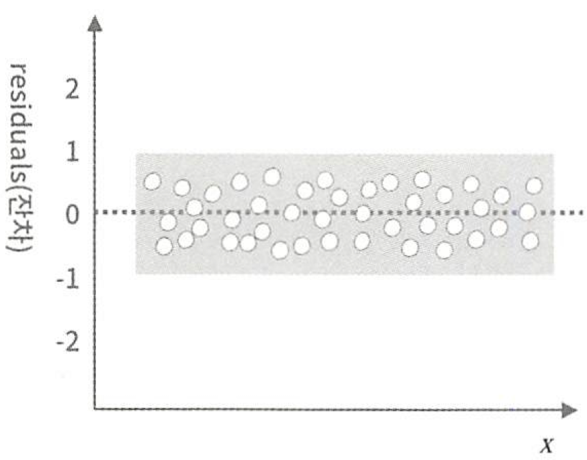</div>

---

### 등분산성

- 오차의 분산이 입력변수와 무관하게 일정하다 .
- 잔차플롯(산점도)를 활용하여 잔차와 입력 변수간에 아무런 관련성이 없게 무작위적으로 고루 분포되어야 등분산성 가정을 만족하게 된다 .
- 설명변수(X)에 대한 잔차의 산점도를 그렸을 때, 왼쪽의 그림과 같이 설명변수(X) 값에 관계없이 잔차들의 변동성 (분산)이 일정한 형태를 보이면 선형회귀분석의 가정 중 등분산성을 만족한다고 볼 수 있다 .

<div class="fill-img">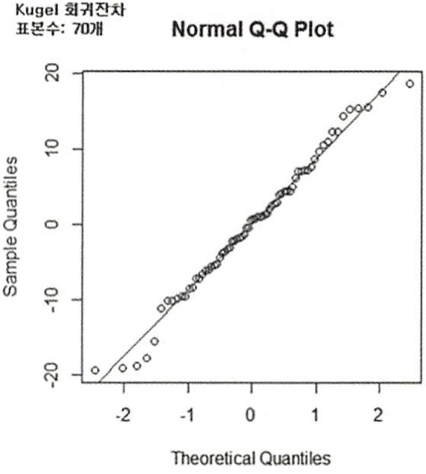</div>

---

### 선형회귀분석의 가정 (계속)

<div class="kicker">정상성 (정규성)</div>

- Q-Q Plot을 출력했을 때, 왼쪽의 그림과 같이 잔차가 대각방향의 직선의 형태를 지니고 있으면 잔차는 정규분포를 따른다고 할 수 있다 .
- 오차의 분포가 정규분포를 따른다 . Q-Q plot, Kolmogolov-Smirnov 검정 , Shaprio-Wilk 검정 등을 활용하여 정규성을 확인한다 .

<div class="kicker">독립성</div>

- 입력변수와 오차는 관련이 없다.
- 자기상관 (독립성)을 알아보기 위해 Durbin-Waston 통계 량을 사용하며 주로 시계열 데이터에서 많이 활용한다 .

<div class="kicker">비상관성</div>

- 오차들끼리 상관이 없다.

---

### 5) 가정에 대한 검증

<div class="kicker">단순선형회귀분석</div>

입력변수와 출력변수간의 선형성을 점검하기 위해 산점도를 확인한다 .

<div class="kicker">다중선형회귀분석</div>

선형회귀분석의 가정인 선형성 등분산성，독립성 정상성이 모두 만족하는지 확인해야 한다 .

<div class="fill-img">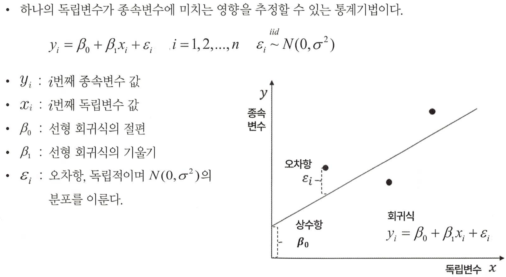</div>

---

### 6) 회귀분석의 종류

<div class="fill-img">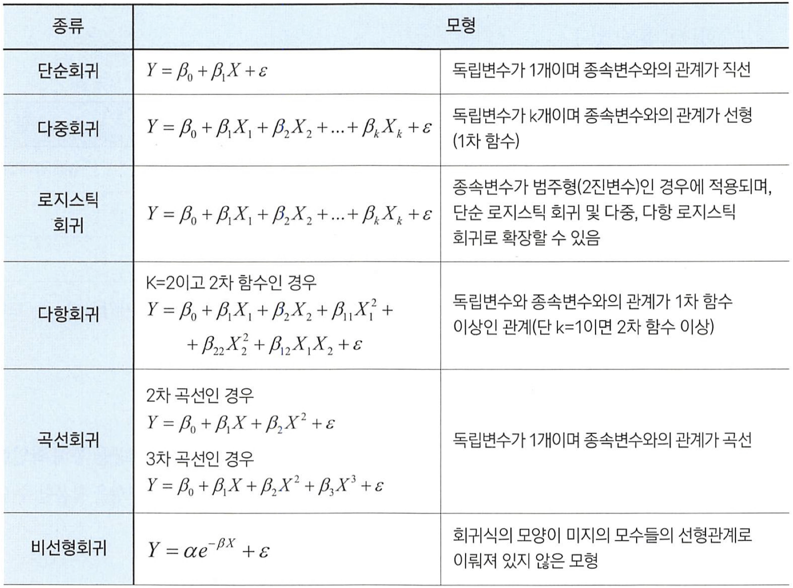</div>

---
layout: section
---

# #02. 회귀분석 통계 검정

---

### 1) 예측변수(회귀계수)들이 유의미한가 ?

- 각 독립변수($x$)의 회귀계수($b$)가 유의한가?
- t-검정을 사용
- 해당 계수의 t 통계량의 p-값이 0.05 보다 작으면 해당 회귀계수가 통계적으로 유의하다고 볼 수 있다.

---

### 2) 모형이 얼마나 설명력을 갖는가 ?

- 만들어진 회귀모형(예측모형)이 유의한가?
- 주어진 모든 변수들이 함께 어느 정도 예측변수의 변량을 설명(예측)하는가?
- 결정계수 ($R^2$)를 확인한다 . 결정계수는 0~1 값을 가지며，높은 값을 가질수록 추정된 회귀식의 설명력이 높다 .

---

### 3) 모형이 데이터를 잘 적합하고 있는가 ?

- 잔차를 그래프로 그리고 회귀진단을 한다 .

---
layout: section
---

# #03. cars 데이터를 활용한 회귀분석

---

### 1) 데이터 확인하기

1920년대에 조사된 데이터로, 차량이 달리는 속도와 그 속도에서 브레이크를 잡았을 때 제동거리를 측정한 데이터.

R에 기본적으로 내장되어 있다.

```r
head(cars)
```

<div class="fill-img">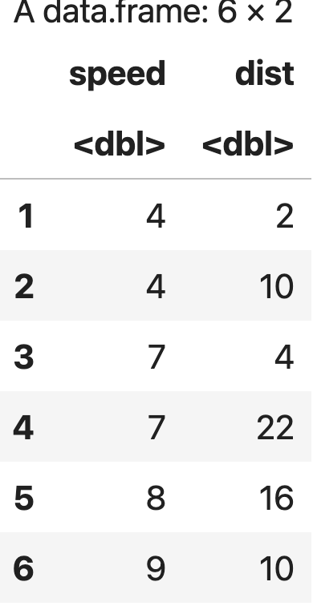</div>

---

### 2) 데이터 분포 조사 — 히스토그램을 통해 데이터 분포를 조사한다.

```r
# 화면을 1행 2열로 분할함
par(mfrow=c(1,2))
# 속도에 대한 히스토그램
hist(cars$speed)
# 제동거리에 대한 히스토그램
hist(cars$dist)
# 화면을 다시 1행 1열로 원복함
par(mfrow=c(1,1))
```

<div class="fill-img">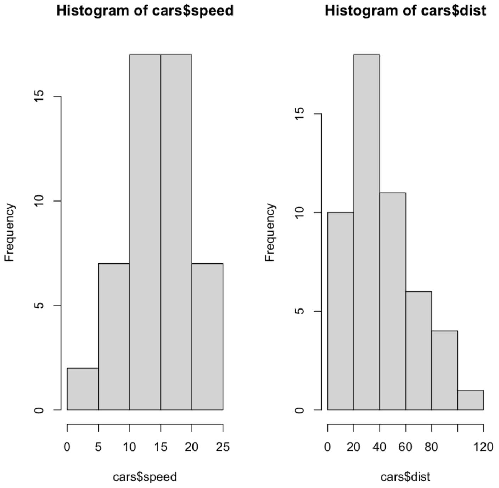</div>

---

### 산점도 그래프를 통한 데이터 분포 조사

```r
plot(dist~speed,data=cars)
```

<div class="fill-img">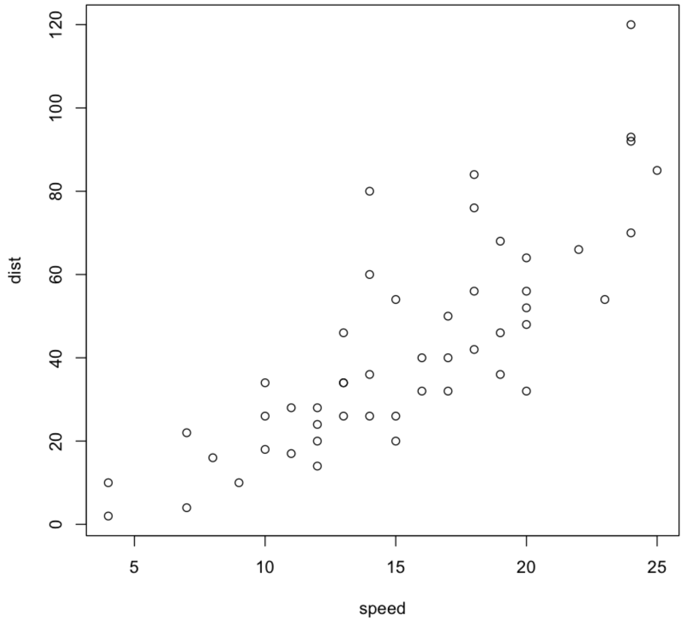</div>

---

### 3) 속도에 따른 제동거리에 대한 회귀분석

R에서 회귀분석은 `lm()` 함수를 사용하고, 결과는 `lm()` 함수로부터 리턴받은 객체를 `summary()` 함수에 전달하여 확인할 수 있다.

```r
model = lm(dist ~ speed, data = cars)
summary(model)
```

<div class="fill-img">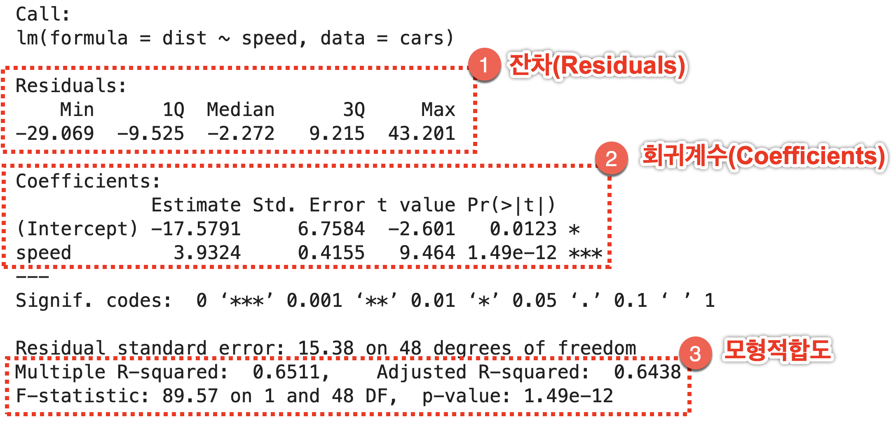</div>

---

### 4) 회귀분석결과 해석하기 — 잔차(Residuals)

<Output>

```text
Residuals:
    Min      1Q  Median      3Q     Max
-29.069  -9.525  -2.272   9.215  43.201
```

</Output>

- 잔차는 예측값과 실제값의 차이를 나타낸다.
- 잔차의 최솟값(Min), 사분위수(1Q, Median, 3Q), 최댓값(Max)을 보여준다.
- 중앙값(median)이 0에 가깝고, 1사분위 점수(Q1)와 3사분위 점수(Q3)가 거의 대칭을 이루고 있으므로, 잔차가 정규분포에서 거의 벗어나지 않았다고 볼 수 있다.

---

### 회귀계수(Coefficients)

<Output>

```text
Coefficients:
            Estimate                    Pr(>|t|)
(Intercept) -17.5791                      0.0123
speed         3.9324                    1.49e-12
```

</Output>

- Estimate는 데이터로부터 얻은 계수의 추정치(estimate)를 말한다.
- 절편(Intercept)의 추정치는 -17.5791로, speed가 0일 때 dist의 값이다.
- speed의 계수 추정치는 3.9324로 speed가 1 증가할 때마다 dist가 3.9324 증가한다는 것을 의미한다.

---

### 회귀계수(Coefficients) (계속)

- 추정치의 오른쪽 끝의 `Pr(>|t|)`는 모집단에서 계수가 `0`일 때, 현재와 같은 크기의 표본에서 이러한 계수가 추정될 확률인 `p`값을 나타낸다.
- 이 확률이 매우 작다는 것은, 모집단에서 `speed`의 계수가 정확히 `3.9324`는 아니더라도 현재의 표본과 비슷하게 0보다 큰 어떤 범위에 있을 가능성이 높다는 것을 의미한다.
- 보통 `5%`와 같은 유의수준을 정하여 `p`값이 그보다 작으면(p < 0.05), "통계적으로 유의하다"라고 한다.
- 즉, speed가 증가할 때 기대되는 dist의 변화는 유의수준 5%에서 통계적으로 유의미하다.

---

### 회귀식

$$
dist = -17.5791 + 3.9324 × speed
$$

---

### 모형적합도

<Output>

```text
Multiple R-squared:  0.6511,    Adjusted R-squared:  0.6438
F-statistic: 89.57 on 1 and 48 DF,  p-value: 1.49e-12
```

</Output>

Multiple R-squared, Adjusted R-squared, F-statistic, p-value는 모형이 데이터에 잘 맞는 정도를 보여주는 지표들이다.

<div class="kicker">Multiple R-squared: 0.6511</div>

- 모형 적합도(혹은 설명력)
- `dist`의 분산을 `speed`가 약 65%를 설명한다
- 각 사례마다 dist에 차이가 있다.

---

### 모형적합도 (계속)

<div class="kicker">Adjusted R-squared: 0.6438</div>

- 독립변수가 여러 개인 다중회귀분석에서 사용
- 독립변수의 개수와 표본의 크기를 고려하여 R-squared를 보정
- 서로 다른 모형을 비교할 때는 이 지표가 높은 쪽은 선택한다

<div class="kicker">F-statistic: 89.57 on 1 and 48 DF, p-value: 1.49e-12</div>

- 회귀모형에 대한 (통계적) 유의미성 검증 결과, 유의미함 (p < 0.05)
- 즉, 이 모형은 주어진 표본 뿐 아니라 모집단에서도 의미있는 모형이라 할 수 있음

---

### 5) 결과보고

논문 등에서 회귀분석의 결과는 다음 순서대로 보고한다.

<div class="kicker">모형적합도 보고</div>

`F분포`(연속확률분포)의 파라미터 2개와 그 때의 `F값`, `p-value`와 유의수준의 비교를 적시한다.

> `dist`에 대하여 `speed`로 예측하는 회귀분석을 실시한 결과, 이 회귀모형은 통계적으로 유의미하였다. `(F(1,48) = 89.57, p < 0.05)`.

<div class="kicker">독립변수 보고</div>

> `speed`의 회귀계수는 `3.9324`로, `dist`에 대하여 유의미한 예측변인인 것으로 나타났다 `(t(48) = 9.464, p < 0.05)`.

---
layout: section
---

# #04. Galton 데이터를 예제로 회귀분석

---

### 1) 데이터 확인하기

galton 데이터는 `UsingR` 패키지에 포함된 샘플로 928개의 부모의 평균키와 아이의 키에 대한 자료이다.

<div class="kicker">패키지 설치하기</div>

```r
REPO_URL <- "https://cran.seoul.go.kr/"

if (!require("UsingR")) {
    install.packages("UsingR", repos=REPO_URL)
}
library(UsingR)
```

---

### 데이터 확인하기

```r
head(galton)
```

<div class="fill-img">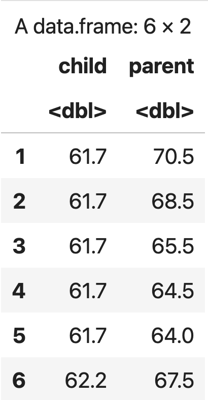</div>

---

### 2) 데이터 분포 조사 — 히스토그램을 통해 데이터 분포를 조사한다.

```r
par(mfrow=c(1,2))
hist(galton$child)
hist(galton$preant)
par(mfrow=c(1,1))
```

<div class="fill-img">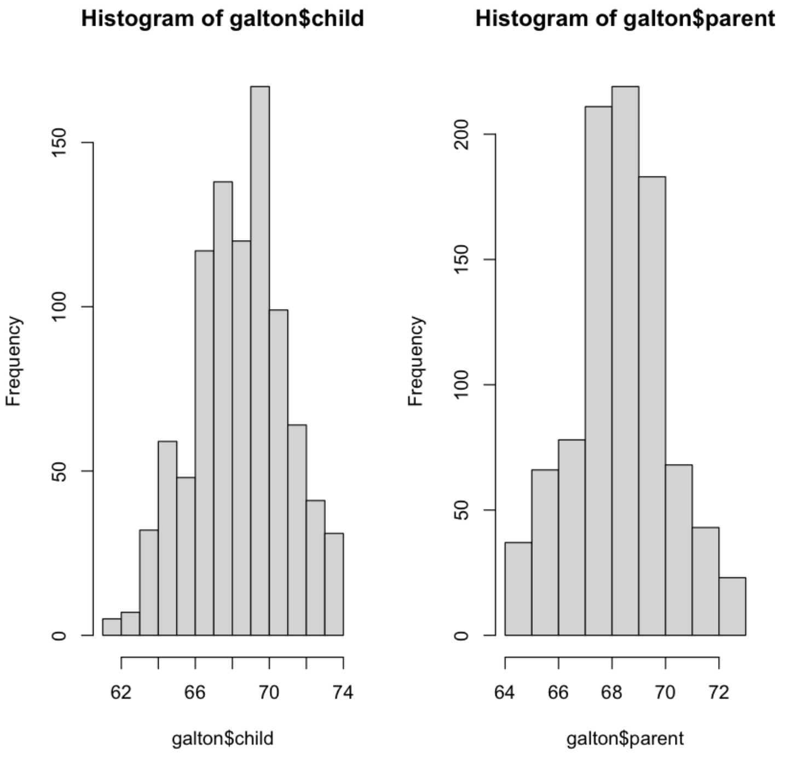</div>

---

### 산점도 그래프를 통한 데이터 분포 조사

```r
plot(child~parent,data=galton)
```

<div class="fill-img">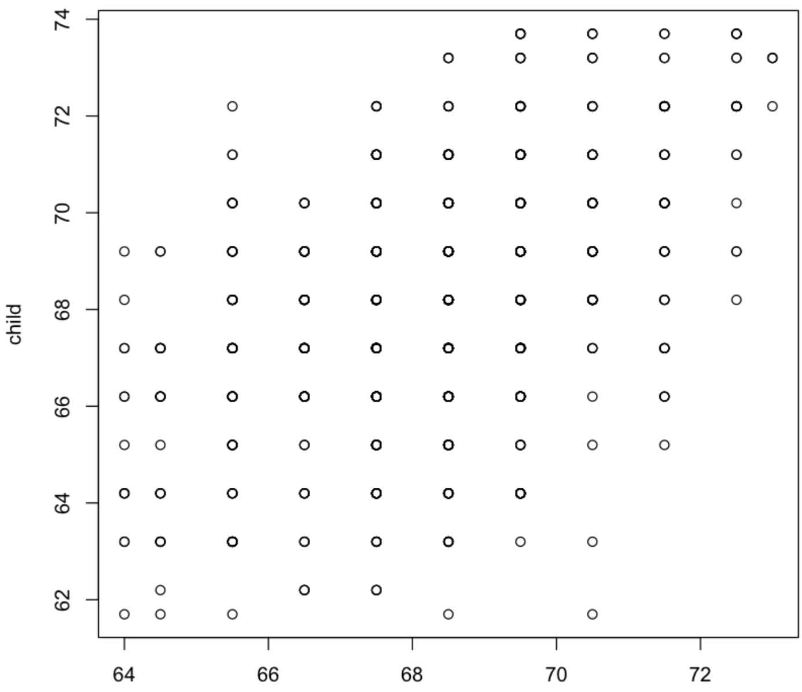</div>

---

### 3) 부모키에 따른 자식 키에 대한 회귀분석

R에서 회귀분석은 `lm()` 함수를 사용하고, 결과는 `lm()` 함수로부터 리턴받은 객체를 `summary()` 함수에 전달하여 확인할 수 있다.

```r
lm_model <- lm(child~parent, data=galton)
summary(lm_model)
```

<div class="fill-img">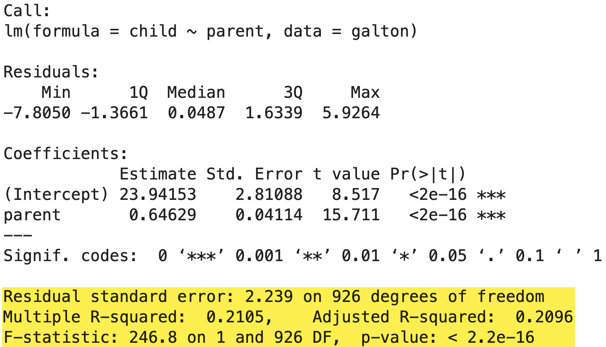</div>

---

### 4) 회귀분석결과 해석하기

<div class="kicker">잔차</div>

중앙값(median)이 0에 가깝고(`0.0487`), 1사분위 점수(Q1)와 3사분위 점수(Q3)가 거의 대칭을 이루고 있으므로, 잔차가 정규분포에서 거의 벗어나지 않았다고 볼 수 있다.

<div class="kicker">회귀계수</div>

- 절편(Intercept)의 추정치: `23.94153`
- p-value가 $`2.2e-16`$ 로 나타나 유의 수준은 0.05보다 작으므로 회귀계수의 추정치들이 "통계적으로 유의하다"

---

### 4) 회귀분석결과 해석하기 (계속)

<div class="kicker">결정계수</div>

- 결정계수(0~1사이)는 `0.2105` 로 다소 낮게 이 모형은 자녀키 분산의 21.0%를 설명해준다는 뜻이다.

<div class="kicker">회귀식</div>

- `parent`의 계수 추정치: `0.64629`로 `parent`가 1 증가할 때마다 `child`가 `0.64629`증가.

$$
child = 23.94153 + 0.64629 \times parent
$$

---

### 분석결과를 그래프로 표현하기

```r
plot(child~parent,data=galton)
abline(lm_model,col="red")
```

<div class="fill-img">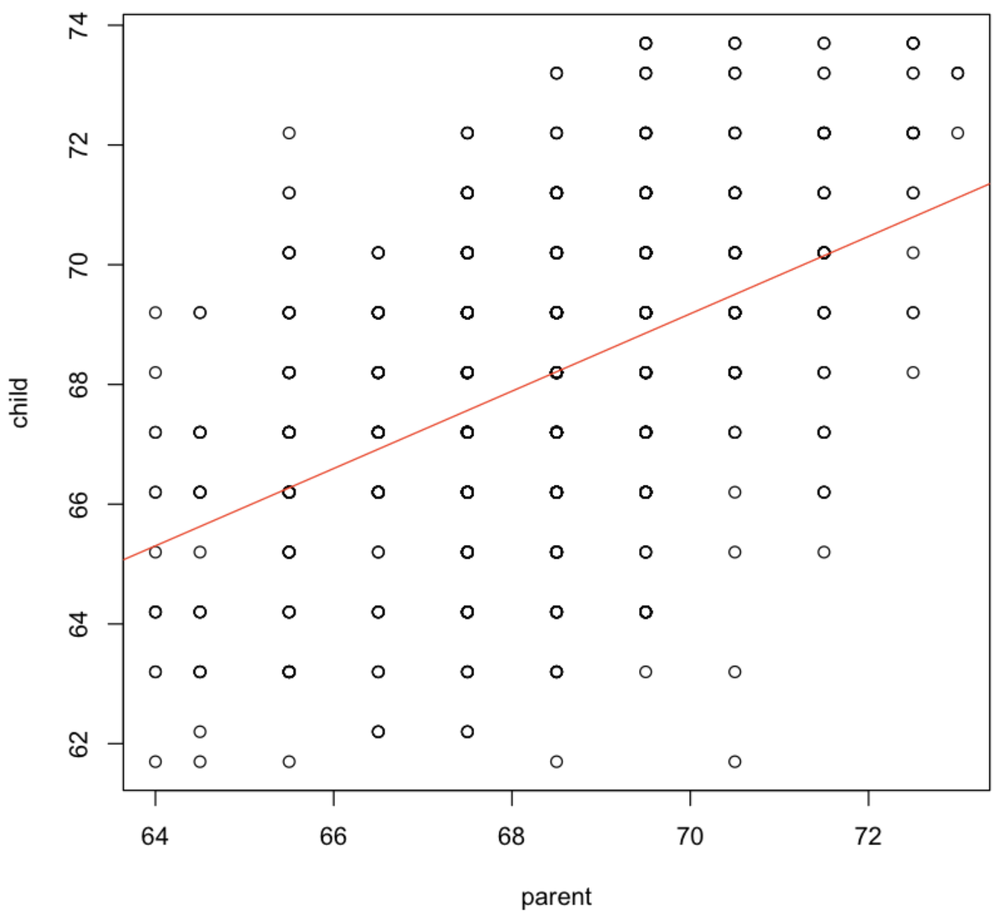</div>

---

### 5) 결과보고

<div class="kicker">모형적합도 보고</div>

> 자식의 키`child`에 대하여 부모의 평균키 `parent`로 예측하는 회귀분석을 실시한 결과, 이 회귀모형은 통계적으로 유의미하였다. `(F(1,926) = 246.8, p < 0.05)`.

<div class="kicker">독립변수 보고</div>

> `parent`의 회귀계수는 `0.64629`로, `child`에 대하여 유의미한 예측변인인 것으로 나타났다 `(t(926) = 15.717, p < 0.05)`.

---
layout: section
---

# #05. 10년간 에어컨 예약대수에 따른 판매대수 회귀분석

---

### 1) 데이터 확인하기

에어컨의 예약대수 $`x`$와 판매대수 $`y`$에 대한 가상의 데이터를 정의한다.

<div class="kicker">데이터 정의하기</div>

```r
# 10년간 에어컨 예약대수
x <- c(19, 23, 26, 29, 30, 38, 39, 46, 49)
# 10년간 에어컨 판매대수
y <- c(33, 51, 40, 49, 50, 69, 70, 64, 89)
# 데이터프레임으로 병합
aircon = data.frame(x, y)
aircon
```

<div class="fill-img">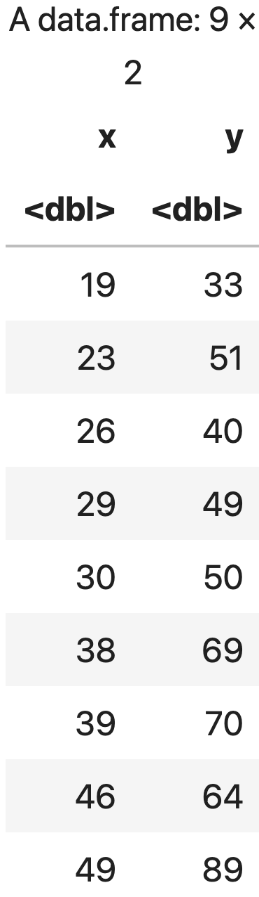</div>

---

### 2) 데이터 분포 조사 — 히스토그램을 통한 분포 조사

```r
par(mfrow=c(1,2))
hist(aircon$x)
hist(aircon$y)
par(mfrow=c(1,1))
```

<div class="fill-img">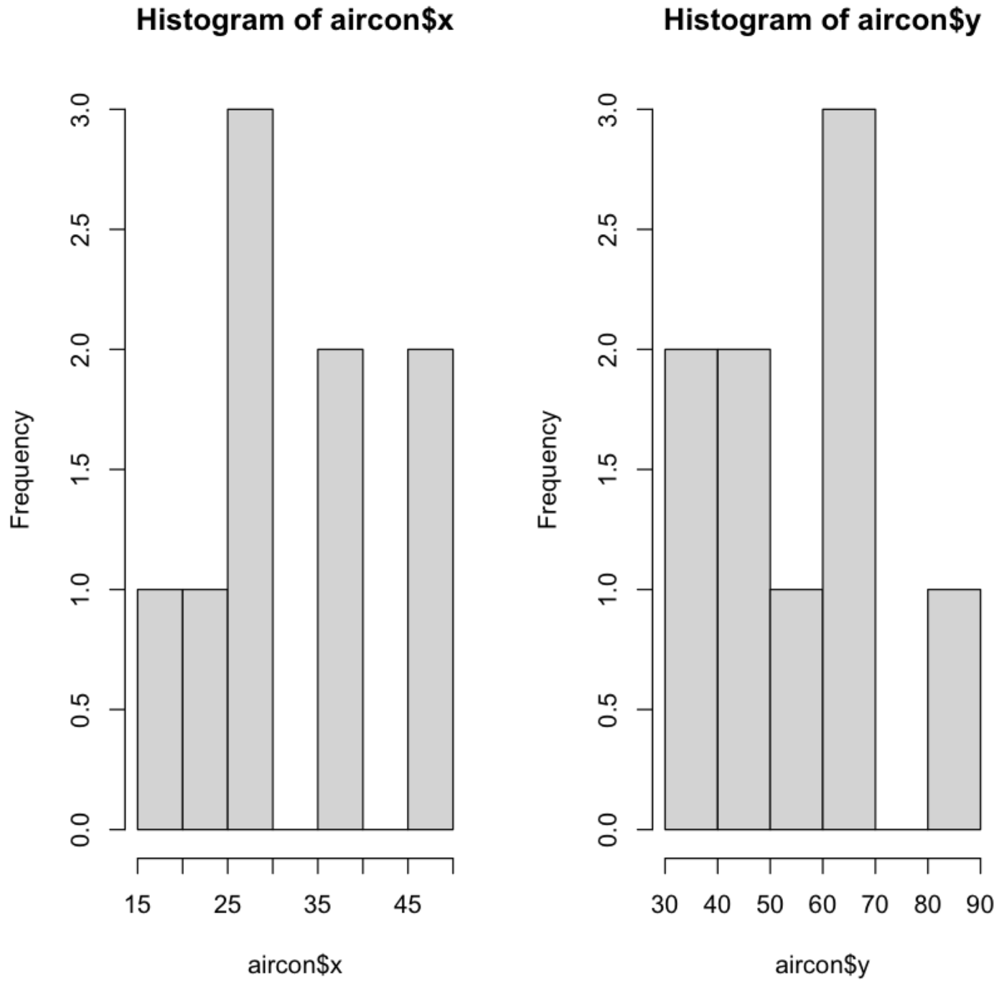</div>

---

### Q-Q Plot을 통한 데이터 분포 조사

```r
plot(y~x,data=aircon)
```

<div class="fill-img">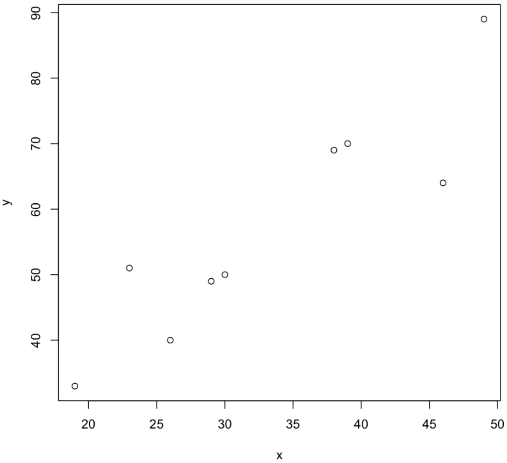</div>

---

### 3) 에어컨 예약 대수에 따른 판매 대수를 예측하기 위한 회귀분석

```r
model = lm(y ~ x, data = aircon)
summary(model)
```

<Output>

```text
Call:
lm(formula = y ~ x, data = aircon)

Residuals:
    Min      1Q  Median      3Q     Max
-12.766  -2.470  -1.764   4.470   9.412
```

</Output>

---

### 3) 에어컨 예약 대수에 따른 판매 대수를 예측하기 위한 회귀분석 (계속)

<Output>

```text
Coefficients:
            Estimate Std. Error t value Pr(>|t|)
(Intercept)   6.4095     8.9272   0.718 0.496033
x             1.5295     0.2578   5.932 0.000581 ***
---
Signif. codes:  0 ‘***’ 0.001 ‘**’ 0.01 ‘*’ 0.05 ‘.’ 0.1 ‘ ’ 1

Residual standard error: 7.542 on 7 degrees of freedom
Multiple R-squared:  0.8341,	Adjusted R-squared:  0.8104
F-statistic: 35.19 on 1 and 7 DF,  p-value: 0.0005805
```

</Output>

---

### 4) 결과해석

<div class="kicker">잔차</div>

중앙값(median)이 0에 가깝고(-1.764), 1사분위 점수(Q1)와 3사분위 점수(Q3)가 거의 대칭을 이루고 있으므로, 잔차가 정규분포에서 거의 벗어나지 않았다고 볼 수 있다.

<div class="kicker">회귀계수</div>

- 절편(Intercept)의 추정치: `6.4095`
- p-value가 `0.0005805` 로 나타나 유의 수준은 0.05보다 작으므로 회귀계수의 추정치들이 "통계적으로 유의하다"

---

### 4) 결과해석 (계속)

<div class="kicker">결정계수</div>

- 결정계수(0~1사이)는 `0.8341` 으로 높게 나타나 이 회귀식이 데이터를 적절하게 설명하고 있다고는 할 수 있다 .
- 결정계수가 높아 데이터의 설명력이 높고 회귀분석결과에서 회귀식과 회귀계수들이 통계적으로 유의하므로 에어컨 판매대수를 에어컨 에약대수로 추정할 수 있다 .

<div class="kicker">회귀식</div>

- `x`의 계수 추정치: `1.5295`로 `x`가 1 증가할 때마다 `y`가 `1.5295`증가.

$$
y = 1.5295 \times x + 6.4095
$$

---

### 5) 결과보고

<div class="kicker">모형적합도 보고</div>

> 에어컨 예약대수x에 대한 판매대수y를 예측하는 회귀분석을 실시한 결과, 이 회귀모형은 통계적으로 유의하였다. (F(1,7) = 35.19, p < 0.05).

<div class="kicker">독립변수 보고</div>

> x의 회귀계수는 1.5295로, y에 대하여 유의미한 예측변인인 것으로 나타났다.
(t(7) = 5.932, p < 0.05).

---

### 분석결과를 그래프로 표현하기

```r
plot(y~x,data=aircon)
abline(model,col="red")
```

<div class="fill-img">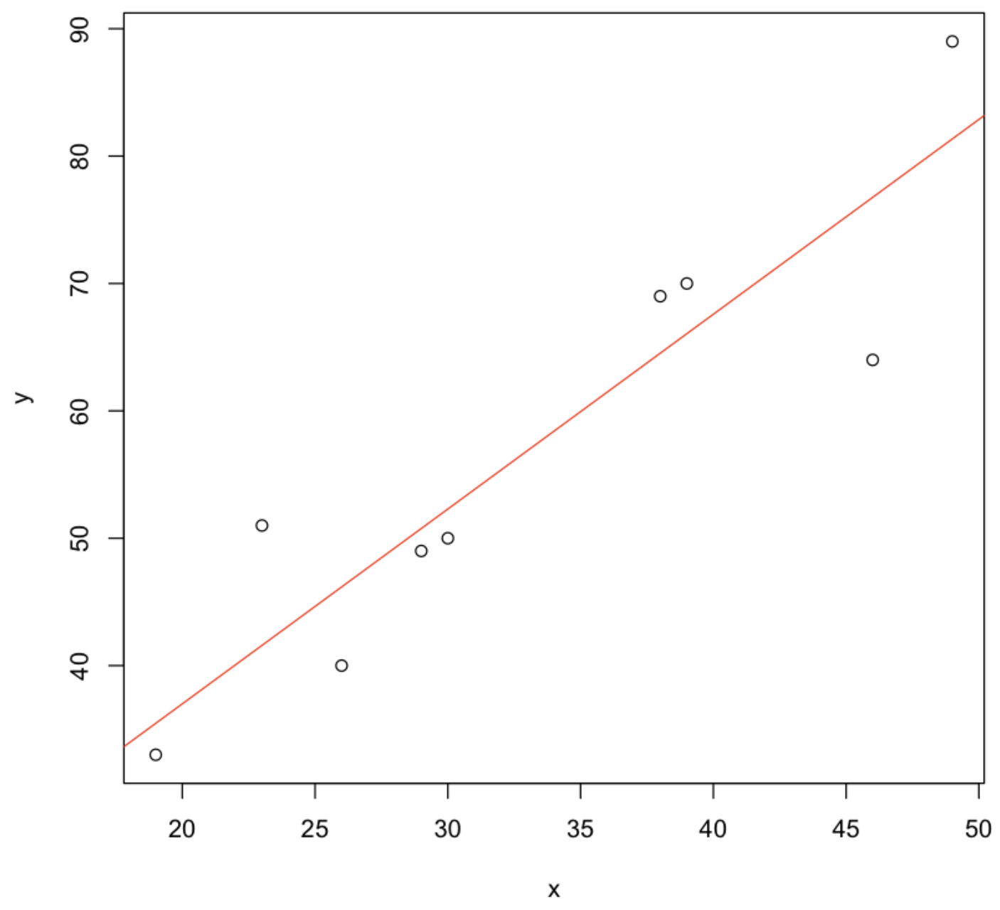</div>
