# 아산 가을 당일치기

우쭈쭈님을 위한 역사 · 은행나무 · 온천 코스

서울 출발 · 자동차 이동 · 시간표 없음

<Timeline color="ai" center>
<li class="now"><b>출발일</b>토 10/31 추천</li>
<li><b>01</b>외암민속마을 🍡</li>
<li><b>02</b>외암파전 상전</li>
<li><b>03</b>현충사</li>
<li><b>04</b>곡교천 은행나무길</li>
<li><b>05</b>신천탕</li>
<li><b>귀가</b>서울</li>
</Timeline>

---

## 출발일과 경로 — 토요일 10/31 추천

<Core color="ai">우쭈쭈님, 맑은 토요일 10/31에 가요. 외암 → 상전 → 현충사 → 은행나무길 → 신천탕 순서예요.</Core>

<Grid cols="2" gap="12 24">
<Tile kind="soft" color="ok" tag="☀️ 추천 · 토요일 10/31" title="맑음 · 8~15℃ · 강수 0%">종일 맑음, 밤부터 흐려짐. 북서풍에 체감은 쌀쌀 → 우쭈쭈님 겉옷 필수</Tile>
<Tile kind="soft" color="danger" tag="🌧️ 일요일 11/1" title="흐림 · 4~14℃ · 비 5~10mm">오전 9~12시부터 비, 종일 흐림. 현충사 입장 마감도 16:00으로 당겨짐</Tile>
</Grid>

<Flow color="pastel">
<li>🏘️<b>외암민속마을</b>🍡 즉석 인절미</li>
<li>🍽️<b>외암파전 상전</b>저잣거리 점심</li>
<li>🏛️<b>현충사</b>이순신 유적</li>
<li>🍂<b>은행나무길</b>곡교천 가을 산책</li>
<li>♨️<b>신천탕</b>온천욕 후 귀가</li>
</Flow>

서울 → 외암민속마을 약 1시간 40분(정체 제외) · 10월 30일 11시 발표된 일기예보 기준

---
layout: magazine
class: tight
---

# 01 · 외암민속마을

500년 역사의 살아 있는 민속 마을. 초가와 기와집 사이 돌담길을 걷는다.

<Chip color="ai">내비 검색</Chip> 외암민속마을 · <Chip kind="fill">주소</Chip> 충남 아산시 송악면 외암민속길 5

<Tile kind="fill" color="yellow" tag="🍡 우쭈쭈님 기대 포인트" title="떡메치기 즉석 인절미 — 마을 안 체험장">떡메로 친 찰떡에 콩고물을 묻혀 바로 잘라 판다 · 한 팩 3,000원 · 옆에서 식혜 3,000원</Tile>

<Grid cols="3" gap="12">
<Tile kind="soft" color="ok" tag="입장 시간" title="09:00~18:00">11월부터는 17:00 마감</Tile>
<Tile kind="soft" color="py" tag="입장료" title="어른 2,000원">7세 이하 · 65세 이상 무료</Tile>
<Tile kind="soft" color="py" tag="휴무 · 주차" title="연중무휴 · 무료">마을 안 차량 진입 금지</Tile>
</Grid>

<Core>09시 개장에 맞춰 도착해 한적하게 돌아요. 인절미 치는 시간대는 입장하면서 안내판으로 확인해 맞춰 가요.</Core>

::right::

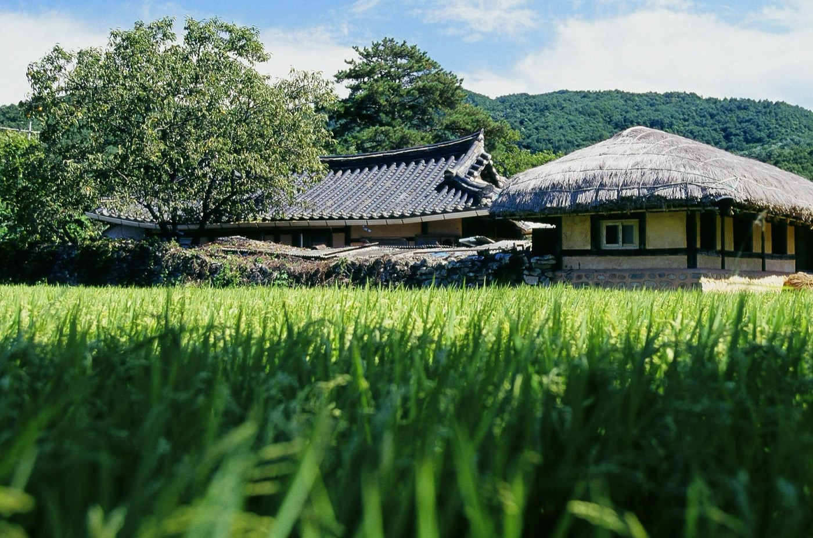

초가와 기와집이 섞인 외암마을 풍경

<!--
사진: Wikimedia Commons "Oeam Folk Village, 2006 (1)" (Flickr, CC BY 2.0)
-->

---
layout: magazine
---

# 02 · 먹거리 — 외암파전 상전

외암마을 저잣거리의 파전집. 곡물가루 반죽으로 두툼하게 부친 파전이 대표 메뉴.

<Chip color="ai">내비 검색</Chip> 외암파전 상전 · <Chip kind="fill">주소</Chip> 충남 아산시 송악면 외암로 1030-14

<Grid cols="3" gap="12">
<Tile kind="soft" color="ok" tag="영업" title="10:00~19:30">연중무휴 10시~마지막 주문 19:00</Tile>
<Tile kind="soft" color="py" tag="대표 메뉴" title="해물파전 · 녹두전">반반(해물+김치) 파전 · 모둠전 · 국밥 · 국수. 테이블 키오스크 주문</Tile>
<Tile kind="soft" color="py" tag="주차" title="외암민속마을 제2주차장">또는 저잣거리 후문 주차장</Tile>
</Grid>

<Core>파전이 질리면 대안은 고은밥상(한식 · 연잎밥) 

11:30 ~ 14:00까지 영업 (이후 브레이크타임)
</Core>

::right::

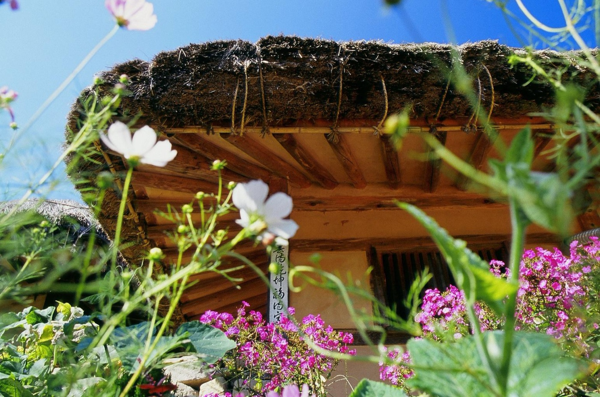

외암마을 초가 처마와 가을꽃

<!--
사진: Wikimedia Commons "Oeam Folk Village, 2006 (3)" (Flickr, CC BY 2.0)
-->

---
layout: magazine
---

# 03 · 현충사

이순신 장군을 기리는 사당과 넓은 경내. 관람 소요 약 1시간.

<Chip color="ai">내비 검색</Chip> 현충사 · <Chip kind="fill">주소</Chip> 충남 아산시 염치읍 현충사길 48

<Grid cols="3" gap="12">
<Tile kind="soft" color="ok" tag="토 10/31" title="09:00~18:00">하절기(3~10월) · 입장 마감 17:00</Tile>
<Tile kind="soft" color="warn" tag="일 11/1" title="09:00~17:00">동절기(11~2월) · 입장 마감 16:00</Tile>
<Tile kind="soft" color="py" tag="휴관 · 요금" title="월요일 휴관 · 무료">경내 음식물 · 반려견 반입 금지</Tile>
</Grid>

<Core>점심 뒤 바로 이동해서 입장 마감(토 17시 · 일 16시) 전에 도착해요.</Core>

::right::

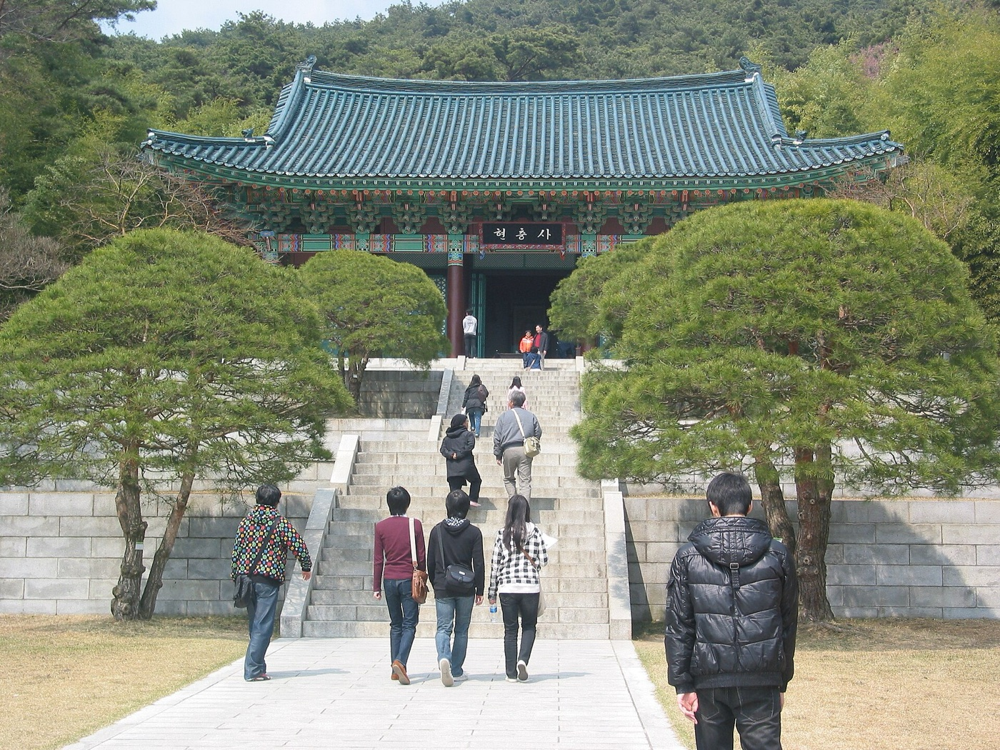

현충사 본전으로 오르는 계단

<!--
사진: Wikimedia Commons "현충사(Hyeonchoong-sa) 01" (Joongi Kim, CC BY-SA 2.0)
-->

---
layout: magazine
---

# 04 · 🍂 곡교천 은행나무길

충무교에서 현충사 입구까지 2.1km 은행나무 터널 입장료 없이 상시 개방.

<Chip color="ai">내비 검색</Chip> 은행나무길 공영주차장 · <Chip kind="fill">위치</Chip> 충남 아산시 염치읍 송곡리 · 백암리 일대

<Grid cols="3" gap="12">
<Tile kind="soft" color="py" tag="주차 (무료)" title="공영주차장 3곳">은행나무길(송곡리 71-9) · 제1(백암리 519-2) · 제2(백암리 258)</Tile>
<Tile kind="soft" color="warn" tag="단풍 상태" title="절정은 11월 초순">10월 말 현장 게시물에는 아직 초록이 많다는 보고. 방문 직전 사진으로 확인</Tile>
<Tile kind="soft" color="ok" tag="행사" title="거리예술제 11/14~15">이번 주말은 행사 없음. 절정기 주말에는 차 없는 거리 운영 가능 → 주차 후 도보</Tile>
</Grid>

<Core>현충사 입구에서 바로 이어져요.

주말 오후는 주차가 혼잡하니 세 주차장 중 빈 곳으로 가요.
</Core>

::right::

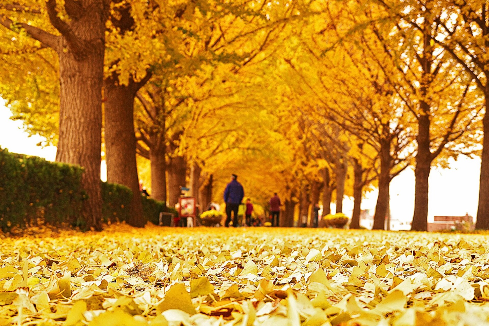

절정기의 은행나무 터널

<!--
사진: Wikimedia Commons "Asan Gingko Tree Road" (travel oriented, CC BY-SA 2.0)
-->

---
layout: magazine
---

# 05 · ♨️ 신천탕 → 귀가

1960년부터 이어온 온양온천 원탕. 온양온천역에서 걸어서 5분.

<Chip color="ai">내비 검색</Chip> 온양온천 신천탕 · <Chip kind="fill">주소</Chip> 충남 아산시 온천대로 1469

<Grid cols="3" gap="12">
<Tile kind="soft" color="ok" tag="영업" title="05:00~18:00">연중무휴. 마감이 이르니 17시 전 입장</Tile>
<Tile kind="soft" color="py" tag="요금" title="대인 10,000원">경로 8,000원 · 세신 등 부대 서비스 별도</Tile>
<Tile kind="soft" color="py" tag="주차" title="주차장 있음">온양온천역 · 온양온천시장 바로 옆</Tile>
</Grid>

<Core>은행나무길에서 17시 전 도착이 목표예요. 늦으면 온천은 다음으로 미루고 바로 집으로.</Core>

::right::

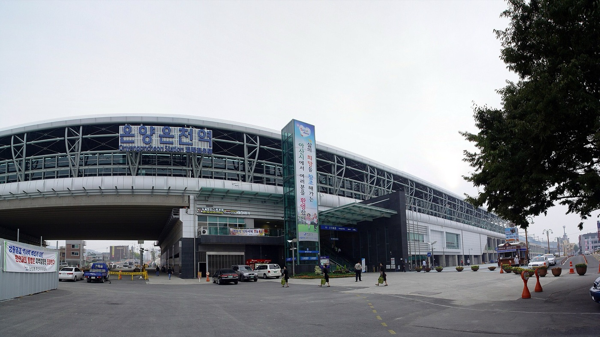

온양온천역 — 신천탕까지 도보 5분

<!--
사진: Wikimedia Commons "2009-09-25 - Panorama outside Onyang Oncheon Station" (Jpbarrass, Public domain)
-->

---
hideInToc: true
---

에필로그 · 토심이의 여행 계획

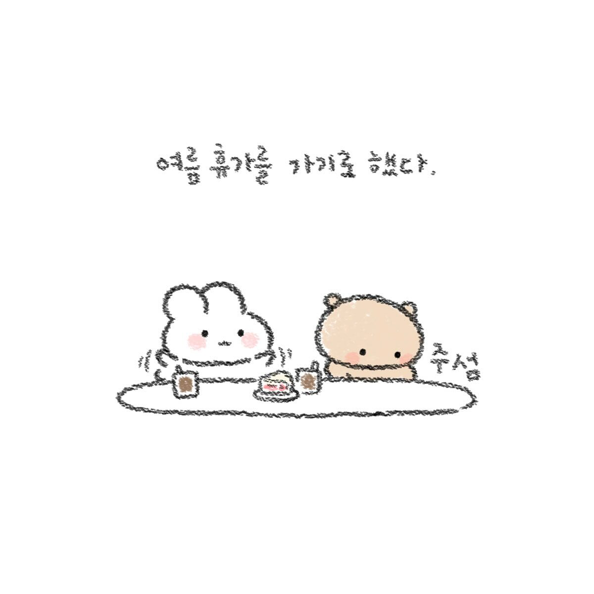

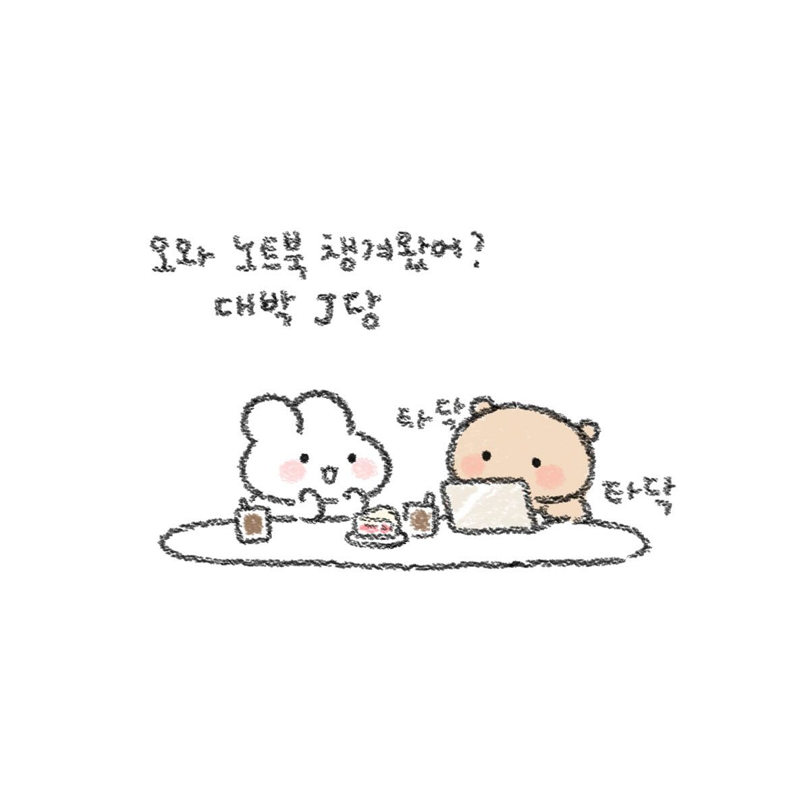

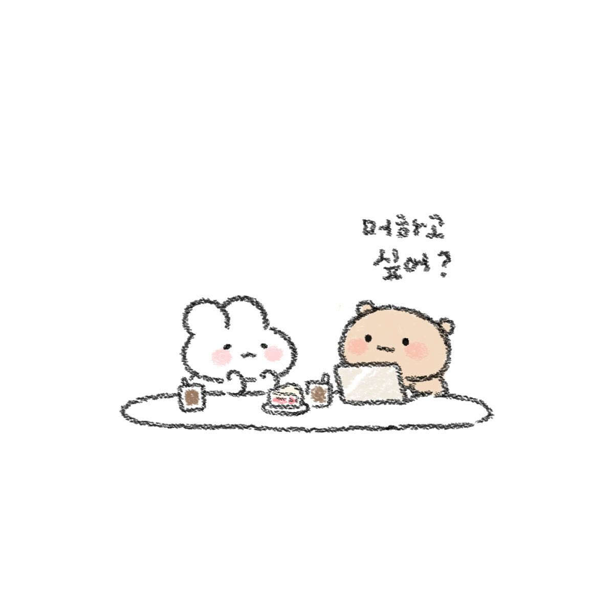

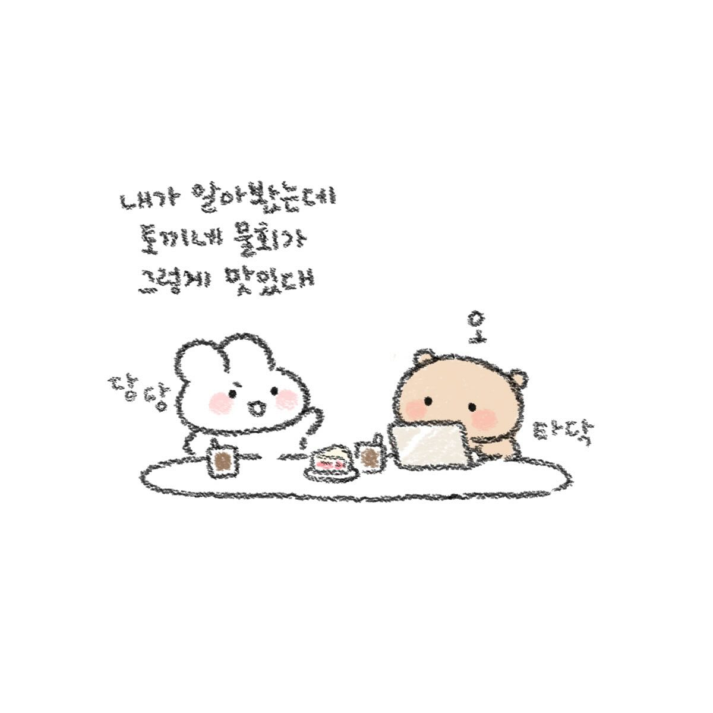

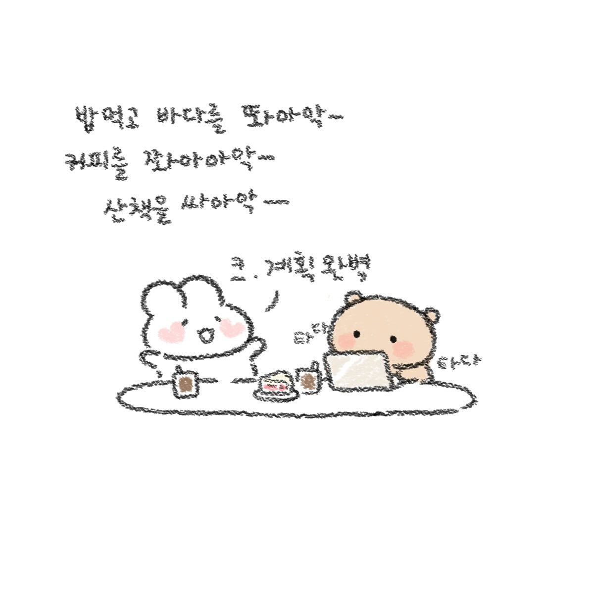

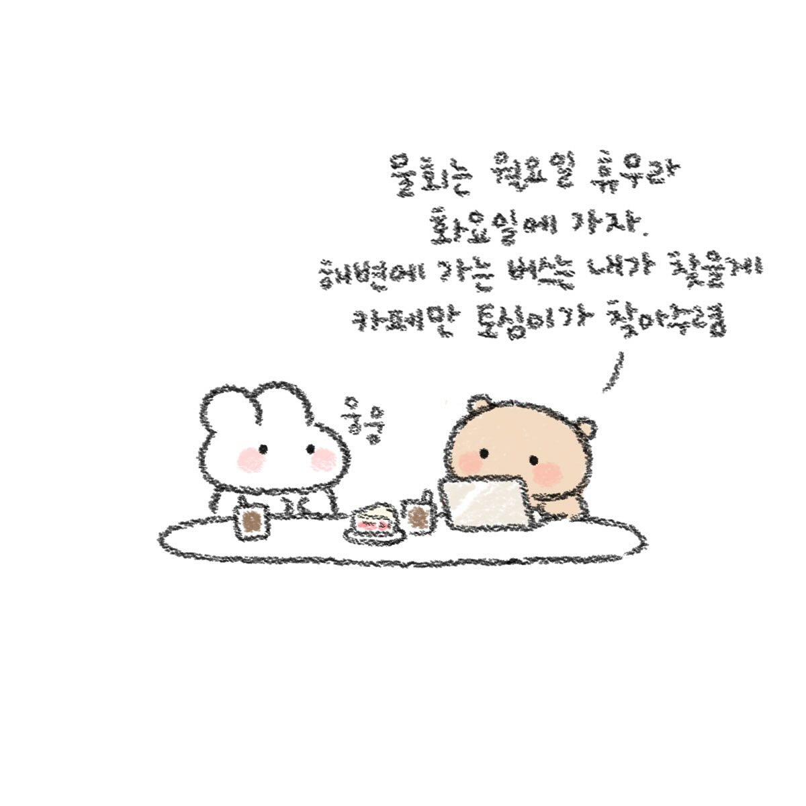

<Core color="ai">우쭈쭈님, 우리 계획도 완벽. 영업시간은 다 체크했어요 ☺️</Core>

<!--
그림: 토심이 인스타툰(@toshimee) 게시물 DM_6pHAv-5w 의 6컷. 개인용 덱에만 사용.
-->
